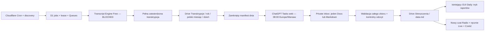

# Transcript Engine i raporty dzienne — decyzja z 12.10.2026

Wymagany dodatkowy koszt: **0,00 zł/miesiąc**. Pełne zdalne pozyskiwanie napisów
z obserwowanych kanałów pozostaje **BLOCKED**. Zdalny test wykonano rzeczywiście
w Cloudflare, a nie w lokalnym workerd. Dla `rUhllpnYWR8` serwer opublikował
angielską ścieżkę automatyczną wymagającą Proof of Origin. Adapter zatrzymał się
z `AUTH_REQUIRED / PROOF_OF_ORIGIN_REQUIRED`. Nie pozyskano pełnej transkrypcji,
nie porównano jej z archiwalnymi 1071 segmentami i nie zapisano jej w Drive.
[Receipt](../verification/daily-workflow/cloudflare-transcript-poc-2026-10-12.json).

Nie wybrano VPS, Containers, proxy, Whisper ani płatnego API. Zmienione adaptery
nie omijają odmowy YouTube, nie tworzą cookies zgody, nie korzystają z prywatnych
cookies ani alternatywnych tożsamości klientów. Kod eksperymentalnego dostawcy
pozostaje niekwalifikowany (`free_eligibility=false`). Nie jest produkcyjnym
sposobem zbierania filmów. Nie można wywnioskować, że każda możliwa darmowa
metoda zawsze zawiedzie; **żadna z zbadanych metod nie została zakwalifikowana
do niezawodnego pobierania pełnego, rzeczywistego zbioru z Cloudflare Free**.

## Stan zastany i delta

Repozytorium zawiera Cloudflare Hono/Assets, D1, Queues i cron co pięć minut.
Cloudflare wykonuje odkrywanie/reconciliation, trwałe jobs/outbox, recovery,
eksporty Drive i kontrolę sesji. `apps/executor/src/providers/ytdlp.ts` uruchamia
przez `execFile` lokalny Python z przypiętymi `yt-dlp@2026.08.19` i EJS 0.8.0.
Ten proces nie jest dostępny w zwykłym Workerze. Kod Pythona zachowuje raw,
tekst źródłowy i segmenty; nie wymaga pobrania pełnego filmu. Zastane mechanizmy
lease, fencing, dedup, klasyfikacji błędów i recovery pozostają autorytatywne.

Produkcja odczytana w tej pracy ma **39 migracji**. Nowa migracja 040 i nowe
widoki są przygotowane w repozytorium. Nie zastosowano ich w produkcji.
Zastane Daily według publikacji, archiwum transkrypcji oraz wcześniejszy pipeline
AI pozostają czytelne. Nowe materiały zapisane w `daily_materials` są pomijane
przez automatyczny planner starego AI i stary eksporter transkrypcji. Nie ma
automatycznego zamiennika ChatGPT Tasks. Nie wykonano wywołania Gemini ani
innego generatora AI. Materiały w `Plan/` i wcześniejsze evidence zachowano.

## Audyt bibliotek

Odczytano GitHub REST (metadata, trzy ostatnie commity, otwarte issues/PR,
drzewa plików), source files przypięte do SHA oraz metadata PyPI. Nie uruchamiano
pobranego kodu tych projektów. Pełne SHA, daty i sumy plików znajdują się w
[evidence](../verification/daily-workflow/library-audit-2026-10-12.json).
Licznik GitHub `open_issues` obejmuje także PR; nie jest liczbą samych błędów.

| Projekt                                                                                                                                                                                       | Zweryfikowany kod, utrzymanie i licencja                                                                                                                                                     | Napisy / języki / czas                                                                                                                                                                                 | Cloudflare i decyzja                                                                                                                                                                                                                                                                                                                                                                  |
| --------------------------------------------------------------------------------------------------------------------------------------------------------------------------------------------- | -------------------------------------------------------------------------------------------------------------------------------------------------------------------------------------------- | ------------------------------------------------------------------------------------------------------------------------------------------------------------------------------------------------------ | ------------------------------------------------------------------------------------------------------------------------------------------------------------------------------------------------------------------------------------------------------------------------------------------------------------------------------------------------------------------------------------- |
| [A: youtube-transcript-api](https://github.com/jdepoix/youtube-transcript-api/tree/8f150ba8836da30a36bcd40e8fca226ed179ba72) / [PyPI](https://pypi.org/project/youtube-transcript-api/1.2.4/) | PyPI 1.2.4 z 29.01.2026; HEAD 09.09.2026, ostatnie commity README; MIT. `requests.Session`, `defusedxml`, GET watch + InnerTube POST + caption GET.                                          | Ręczne i ASR, listy języków, segmenty start/duration. Parser może usuwać markup/puste cues; nie wolno utożsamiać tego z wiernym raw archiwum. Jawnie odmawia `exp=xpe` jako wymagania PoToken.         | Nie jest natywnym adapterem Python Workers. Session/network i consent-cookie code wymagają osobnej kwalifikacji/portu; same wheel/import niczego nie dowodzą. Publiczne [zgłoszenie cloud IP](https://github.com/jdepoix/youtube-transcript-api/issues/593) i [otwarte #612](https://github.com/jdepoix/youtube-transcript-api/issues/612) opisują blokady. Obejścia proxy pominięto. |
| [B: yt-dlp](https://github.com/yt-dlp/yt-dlp/tree/897341241f2bfb2439fe0367f4c7c9ccd29a3828)                                                                                                   | Źródło Unlicense, bundlowane zależności mają własne licencje. Aktywny HEAD 10.10.2026 zmienia domyślnego klienta YouTube na `tv_samsung`. W aplikacji wersja z sierpnia pozostaje przypięta. | Ręczne/automatyczne ścieżki, wiele formatów i języków, timestampy. Obecny adapter archiwizuje pełne dostępne cues, jawnie oznacza partial.                                                             | Subprocess/Python/EJS wymagają normalnego systemu; nie przeniesiono ich do Workers. Containers mogłyby uruchomić program, lecz są płatne i nie usuwają ograniczeń YouTube. Zmiany klientów nie zostały przejęte jako sposób uniknięcia blokady.                                                                                                                                       |
| [C: Akash9078](https://github.com/Akash9078/youtube-transcript-extractor/tree/04b8d974f9b008281fa6163f39ce7b90f3d796f3)                                                                       | Repo dostępne. Dwa commity, ostatni 07.03.2026; brak licencji i kodu ekstraktora w przejrzanym drzewie, README i workflow integracji usługi Apify.                                           | Deklaracje README nie potwierdzają implementacji ani pełnych segmentów.                                                                                                                                | Nie jest samodzielną biblioteką do bezpłatnego wdrożenia w Workerze. Brak podstaw do portowania lub deklaracji skuteczności. Nie wywołano Apify.                                                                                                                                                                                                                                      |
| [D: nonioAlber](https://github.com/nonioAlber/youtube-full-channel-transcripts-extractor/tree/8e8f78c78c598ab1d3f8a412985cf65bdeb32149)                                                       | MIT; historia ograniczona do 11.11.2025. `requests`/BeautifulSoup i runner.                                                                                                                  | `youtube_parser.py` zawiera demonstracyjne, stałe dane oraz komentarz o dummy logic; nie pobiera rzeczywistych ścieżek napisów. W pobranym pliku początek `thonimport` jest dodatkowym błędem składni. | Odrzucony jako źródło transkrypcji. Brak rzeczywistego silnika do kwalifikacji, niezależnie od środowiska.                                                                                                                                                                                                                                                                            |
| [E: Ptyktos MCP](https://github.com/Ptyktos/youtube-transcript-mcp/tree/67e5a65308c5fd9c649a34f8e9c6aa0fcff09825)                                                                             | MIT, Rust; HEAD 11.10.2026. `crates/core`, `native`, `worker`; sprawdzono Worker i parser.                                                                                                   | Track selection, segmenty i eksporty JSON/SRT/VTT/Markdown. Kod używa InnerTube i XML; język fallback wymaga jawnego oznaczenia.                                                                       | Rzeczywisty wariant WASM Workers istnieje. Udostępnione benchmarki mierzą lokalny mock, nie niezawodność sieci Cloudflare. Publiczne CORS/endpoints i ujawniane błędy nie pasują do prywatnej aplikacji bez adaptacji. Nie użyto native Whisper fallback.                                                                                                                             |
| [F: whispr](https://github.com/franckferman/whispr/tree/6cfdb6cfe86b515e95ca81a8cd69dba4d9efa9cf)                                                                                             | AGPL-3.0, HEAD 19.09.2026; otwarte aktualizacje zależności. Sprawdzono backendy i requirements.                                                                                              | Pipeline audio/Whisper, FFmpeg, pliki, chunk processing; opcjonalny OpenAI API. To rozpoznawanie mowy, nie biblioteka samego pobierania napisów.                                                       | Nie pasuje do zwykłego Workers/Pyodide ani budżetu CPU Free. Nie instalowano modeli, nie pobierano audio i nie wykonywano API.                                                                                                                                                                                                                                                        |
| [YouTube.js / youtubei.js](https://github.com/LuanRT/YouTube.js/tree/bad89d2657e88f907011655f199fba9fb615c339)                                                                                | MIT, kod package 18.1.0; HEAD 07.10.2026, aktywne PR zależności. Jawny export `cf-worker`, platform shim korzysta z fetch/WebCrypto/Cache.                                                   | Pełne parsowanie metadanych i `getTranscript`; nadal prywatny InnerTube.                                                                                                                               | Najbardziej dojrzały dodatkowy klient TS, ale większy bundle/session i [otwarte #1102](https://github.com/LuanRT/YouTube.js/issues/1102) o transcript 400 nie dają gwarancji Free/network. Kompatybilność platformowa nie kwalifikuje dostępu do źródła. Nie włączono rotacji klientów ani atestacji.                                                                                 |
| [youtube-transcript-ts](https://github.com/hallelx2/youtube-transcript-ts/tree/3f1cf87566d0003b715a6530aab06e8ea889a004)                                                                      | Package 0.2.0, HEAD 13.04.2026. GitHub NOASSERTION; odczytany LICENSE jest MIT, z przypisaniem do jdepoix.                                                                                   | Port A: manual/ASR, języki, start/duration. Custom fetch.                                                                                                                                              | HTTP jest portowalne, ale `undici`, cookies i opcjonalne proxy nie są gotową kwalifikacją Workers. Tych ścieżek nie użyto.                                                                                                                                                                                                                                                            |
| [youtube-transcript-edge](https://github.com/InvictusNavarchus/youtube-transcript-edge/tree/9faf2a97fb9e10a33011b8d82d89e0f2de88b4de)                                                         | Package 1.2.0, HEAD 28.06.2026; brak potwierdzonego LICENSE, metadata wskazują inne repo fork. Otwarte #11 o zgodności README.                                                               | Source ma HTTP player/captions, track selection i parser XML.                                                                                                                                          | Deklaracja edge nie dowodzi kompletności. Brak licencji i niezakwalifikowane zachowanie sieciowe wykluczają bezpośrednie vendoring/aktywację.                                                                                                                                                                                                                                         |

A–F istnieją w dniu odczytu. **Istnienie projektu, liczba stars i brak issues nie
są dowodem, że ekstraktor działa na rzeczywistym YouTube.** Nasz mały adapter
web jest własną implementacją ograniczonego HTTP/JSON3 i używa zastanego
kontraktu `TranscriptProvider`; nie skopiowano kodu projektu bez licencji.
Metoda web nie jest oficjalnym YouTube Data API i nie potwierdza uprawnienia
do automatycznego pozyskiwania dowolnego materiału. Włączenie wymaga kwalifikacji
dostępu i respektowania odmów źródła.

## Porównanie architektur

| Wariant                  | Uruchomienie bez PC                                    | Warunki techniczne i koszt                                                                                                                                                                                                        | Wynik                                                                                                                                                      |
| ------------------------ | ------------------------------------------------------ | --------------------------------------------------------------------------------------------------------------------------------------------------------------------------------------------------------------------------------- | ---------------------------------------------------------------------------------------------------------------------------------------------------------- |
| A — TS Workers Free      | Tak, dla zakwalifikowanego fetch/parse                 | 10 ms CPU, 128 MB, 50 subrequests; istniejące D1/Queues. Native fetch nie usuwa PoToken/IP/429.                                                                                                                                   | **Preferowany technicznie, BLOCKED dla badanego rzeczywistego filmu.** Adapter i prywatny PoC są zaimplementowane.                                         |
| B — Python Workers       | Tak, jeśli adapter zostanie faktycznie zakwalifikowany | Pyodide/WASM, nie standardowy system. Wheels/dependencies i transport trzeba zweryfikować osobno. Brak normalnego subprocess/Python executor. Ten sam egress i Free CPU.                                                          | Brak zaliczonego testu A w Python Workers; nie deklarujemy PASS. Port sieci nie usunie wymagania atestacji.                                                |
| C — Containers           | Tak                                                    | [Workers Paid $5/miesiąc i usage](https://developers.cloudflare.com/containers/platform/pricing/), start/idle/cold start, stan trzeba trzymać poza dyskiem kontenera. Możliwe yt-dlp/Python; cloud egress nadal podlega blokadom. | **Niedozwolony przy 0 zł. Nie wdrożono.**                                                                                                                  |
| D — hybryda Cloudflare   | Tak                                                    | D1/Queues już istnieją; Queues to sygnały, D1 zachowuje stan również po 24 h retencji kolejki. Workflows mają Free, ale dodatkowe kroki/storage i ten sam limit CPU nie dają dostępu do napisów.                                  | Zachowano obecne D1/Queues/Cron. Nie dodano Workflows/KV/R2 tylko dla tego samego state machine.                                                           |
| E — zewnętrzny wykonawca | Zależnie od hosta                                      | Darmowa biblioteka nie zapewnia darmowego, stale działającego hosta; zewnętrzny egress też może być blokowany.                                                                                                                    | Nie wybrano i nie uruchomiono zewnętrznej infrastruktury.                                                                                                  |
| Oficjalne captions API   | Tak, native HTTP                                       | [Download wymaga prawa edycji filmu i 200 units](https://developers.google.com/youtube/v3/docs/captions/download). List kosztuje 50 units, metadata video typowo 1.                                                               | Adapter REST jest gotowy i testowany na fixture’ach. **Nie jest rozwiązaniem dla wszystkich obserwowanych cudzych kanałów**; brak live edytorskiego OAuth. |

[Python runtime](https://developers.cloudflare.com/workers/languages/python/how-python-workers-work/),
[pakiety](https://developers.cloudflare.com/workers/languages/python/packages/),
[standard library](https://developers.cloudflare.com/workers/languages/python/stdlib/)
nie stanowią potwierdzenia działania `requests.Session` ani systemowego yt-dlp
w tym projekcie. Nie przeprowadzono płatnego testu Containers.

## Kontrakt, retry i granice kwalifikacji

Zachowano `TranscriptProvider`, statuses i source authority policy. Dostawcy
REST/web zwracają wszystkie segmenty, timestampy, język/rodzaj ścieżki, provider
version, retrieval time i raw SHA. Metadane filmu pochodzą z istniejącego intake;
web PoC zachowuje dodatkowo tytuł i nieznany język oryginalny jako `null`.
Nie wnioskujemy o języku audio wyłącznie z dostępnego języka napisów.

Runner obsługuje `local` i `cloud`, sprawdza runtime/provider version, pełny
raw SHA i lease. Cloud uruchomienie dodatkowo wymaga pozytywnego
`freeTranscriptAdmission`: Free plan, PASS źródła i pełnego pipeline’u,
P99 CPU ≤8 ms, telemetria nie starsza niż 10 minut oraz wykorzystanie poniżej
80% limitów konta. Nieznane wartości wstrzymują pracę. Jest to bramka;
**nie jest dowodem ani uruchomionym produkcyjnym collectorem telemetrii dla nowego
silnika**. Zastane narzędzia D1 usage/capacity pozostają dostępne.

Nie ma równoległego fallback fan-out. Odmowa, atestacja, login, CAPTCHA, 403/429,
region i brak napisów są osobnymi wynikami. Pusty/malformed body, brak timingów,
utracony końcowy fragment i przekroczony limit nie mogą dać `OK`. Limity 4 MiB
raw, 32 MiB Markdown, 2000 materiałów/dzień i 1 MiB raportu **wstrzymują** zbyt
duże zadanie; nigdy nie powodują obcięcia treści.

## Końcowy przepływ przygotowanej zmiany

Diagram przedstawia kontrakt przygotowanego workflow, **nie działającą już
automatyzację produkcyjną**. Codzienna data pochodzi z pierwszego zatwierdzenia
pełnego źródła w `Europe/Warsaw`, nie z publikacji. Przekroczenie północy przez
zatwierdzenie przypisuje film do następnego dnia. Drive może być spóźniony;
manifest oznacza go PENDING i raport musi jawnie wskazać nieprzetworzenie.
Źródła partial nie są enrollowane. Dzień ma stałe membership; readback może
zmienić gotowość manifestu przed kompletnym raportem. Zadanie wiąże raport ze
skopiowanym digestem manifestu; zmieniony manifest wymaga ponownego przetworzenia.
Po przyjęciu kompletnego raportu manifest zostaje zamrożony.

Google Docs jest czytany przez `files.export(text/plain)` i publikowany jako
rzeczywisty UTF-8 Markdown, z zachowaniem native source. Nie trzeba przenosić
oryginału ani zmieniać jego permissions. Bezpośredni poprawny `.md` w katalogu
docelowym jest przyjmowany bez kopii. Poprawny kompletny raport nie jest
nadpisywany; partial można zastąpić tylko przez kontrolowane CAS/readback.

## Koszt i wolumen

Aktualnie zakwalifikowana, bezpieczna przepustowość pełnych transkrypcji z
Cloudflare dla obserwowanych kanałów: **0/dzień**, ponieważ źródło i cały
pipeline nie przeszły kwalifikacji. Poniższe wolumeny to scenariusze planowania,
nie obietnica przetworzenia przed 08:00.

| Scenariusz | Filmy/dzień | Filmy/30 dni | Dodatkowy koszt aktywowanych usług | Wykonalność                                                                                                                  |
| ---------- | ----------: | -----------: | ---------------------------------: | ---------------------------------------------------------------------------------------------------------------------------- |
| Mały       |          10 |          300 |                            0,00 zł | BLOCKED dostępem do źródła; CPU/pełny Drive pipeline niezmierzone                                                            |
| Średni     |         100 |         3000 |                            0,00 zł | Jak wyżej; wymaga pomiaru rows/bytes i dzielenia pracy                                                                       |
| Duży       |        1000 |        30000 |                            0,00 zł | Jak wyżej; jeden archive attempt/5 minut daje tylko teoretyczne 288 slotów zwykłej doby, więc nawet bez błędów nie wystarczy |

Sloty nie są liczbą sukcesów. Doba DST ma odpowiednio 276/300 pięciominutowych
slotów. Nie mnożymy lokalnych SQL calls przez cenę jako billed rows. Konto i
limity są współdzielone z innymi aplikacjami, więc pozostałą pojemność trzeba
odczytać z rzeczywistej telemetrii. O godzinie 08:00 nie wolno pozornie zaliczyć
nieodczytanych lub niegotowych materiałów.

| Usługa                                                                             | Aktualny darmowy limit                                                                                                                                                                                                                                              | Zużycie tej zmiany / zabezpieczenie                                                                                                                                                                                                                                                                                                                          | Bezpieczne pełne transkrypcje dziś |   Dodatkowy koszt |
| ---------------------------------------------------------------------------------- | ------------------------------------------------------------------------------------------------------------------------------------------------------------------------------------------------------------------------------------------------------------------- | ------------------------------------------------------------------------------------------------------------------------------------------------------------------------------------------------------------------------------------------------------------------------------------------------------------------------------------------------------------ | ---------------------------------: | ----------------: |
| [Workers Free](https://developers.cloudflare.com/workers/platform/limits/)         | 100000 requests/dzień, 10 ms CPU/invocation, 128 MB, 50 subrequests/request                                                                                                                                                                                         | Plan Free Active potwierdzony w UI; PoC ma jeden chroniony endpoint i jeden film, brak cron/bindings. Nowy workflow OFF. Bramka CPU/80%/stale telemetry.                                                                                                                                                                                                     |                                  0 |           0,00 zł |
| [D1 Free](https://developers.cloudflare.com/d1/platform/pricing/)                  | 5 mln rows read/dzień, 100000 rows written/dzień, 5 GB konta                                                                                                                                                                                                        | Istniejący DB; produkcyjnie tylko 2 ograniczone SELECT w audycie, brak migracji/zapisu. Nowe tabele lokalne. 80% admission i existing usage tools; CPU/rows na pełny film niezakwalifikowane.                                                                                                                                                                |                                  0 |           0,00 zł |
| [Queues Free](https://developers.cloudflare.com/queues/platform/pricing/)          | 10000 operations/dzień; 24 h retention                                                                                                                                                                                                                              | Istniejące sygnały, stan jobs w D1. Brak nowej kolejki/nowych produkcyjnych messages. 3 ops/message to przybliżenie, retry dodaje ops. Bramka 8000.                                                                                                                                                                                                          |                                  0 |           0,00 zł |
| [KV Free](https://developers.cloudflare.com/workers/platform/pricing/#workers-kv)  | 100000 reads, 1000 writes/deletes/lists dziennie, 1 GB                                                                                                                                                                                                              | Nie użyto, brak namespace/binding.                                                                                                                                                                                                                                                                                                                           |                                  0 |           0,00 zł |
| [Workflows Free](https://developers.cloudflare.com/workflows/reference/pricing/)   | Shared 100000 requests/dzień; 10 ms CPU; 3000 steps/dzień; 1 GB-month storage                                                                                                                                                                                       | Nie dodano; nie rozwiązuje odmowy YouTube.                                                                                                                                                                                                                                                                                                                   |                                  0 |           0,00 zł |
| [R2](https://developers.cloudflare.com/r2/pricing/)                                | Standard free tier: 10 GB-month, 1 mln A i 10 mln B ops/miesiąc; nadwyżka płatna                                                                                                                                                                                    | UI pokazuje istniejące R2 Paid innego zastosowania. **Ta zmiana go nie używa**, brak bucket/binding/writes; nie polegamy na billing-enabled free tier.                                                                                                                                                                                                       |                                  0 |           0,00 zł |
| [Google Drive](https://developers.google.com/workspace/drive/api/guides/limits)    | Istniejące miejsce konta; UI 15 GB współdzielone, ok. 397 MB zajęte. Aktualna dokumentacja: 1 mln quota units/min projekt, 325 tys./min użytkownik, 400 mln units/dzień i 1 TB egress/dzień przed progiem rozliczeń; starsze projekty mogą mieć wcześniejsze quota. | Brak rozszerzania planu. 35 requests/tick to maks. 10080 zwykłej doby (10500 DST jesienią); przy konserwatywnych 200 units/request ≤2,1 mln units/dzień samego nowego workflow. To nie pomiar wspólnego użycia projektu. Przed aktywacją sprawdzić faktyczne quota i brak odpłatnego overage. Trwałe IDs, stop/resume i bounded retry. Produkcyjne writes=0. |                                  0 |           0,00 zł |
| [YouTube API quota](https://developers.google.com/youtube/v3/determine_quota_cost) | Typowo 10000 units/dzień, współdzielone z discovery                                                                                                                                                                                                                 | Na film ≥251 units (metadata + list + download), zatem maks. 39 **przed** istniejącym użyciem/retry; potrzebne prawa edycji i offline OAuth. Brak live requests adaptera.                                                                                                                                                                                    |                0 zakwalifikowanych |           0,00 zł |
| ChatGPT Tasks                                                                      | Istniejący plan i dostępne połączenie, limity zależą od konta                                                                                                                                                                                                       | Bez API/model calls i bez zakupu planu. Harmonogram ręczny; status PENDING_OWNER_ACTION.                                                                                                                                                                                                                                                                     |                        Nie dotyczy | 0,00 zł dodatkowo |

Przekroczenie Free limitu wstrzymuje pracę; nie aktywujemy Paid. R2, Containers,
zewnętrzny host i komercyjne API nie są alternatywą uruchamianą po awarii.
Pierwsze pełne source→Drive→Task→canonical readback i P99 CPU są nadal wymagane.

## Bezpłatne drogi do usunięcia rzeczywistej blokady

1. Napisy kanałów, do których właściciel ma prawo edycji: oficjalne captions
   REST API z własnym offline OAuth, w darmowej quota; ograniczone zastosowanie.
2. Pełne pliki dostarczane przez autorów w prywatnym Drive lub autoryzowanym
   źródle HTTP: normalizacja/archiwizacja w obecnym kontrakcie, bez modelu/STT.
   Nie jest to udowodnione automatyczne zbieranie wszystkich obserwowanych kanałów.
3. Ponowna kwalifikacja anonymous published-caption method, jeżeli źródło udostępni
   ją bez wymagania niedozwolonych obejść. Jednorazowy sukces nadal wymaga
   powtórzeń, testu ASR/manual, całego source/readback i pomiaru Free CPU.

Nie ma obecnie potwierdzonej bezpłatnej drogi spełniającej cały zakres dowolnych
kanałów. Instrukcje dalszej konfiguracji i prompt 08:00 są w
[runbooku](../operations/DAILY_REPORTS_AND_RADIO.md). Produkcyjnego workflow
nie można jeszcze bezpiecznie włączyć.
