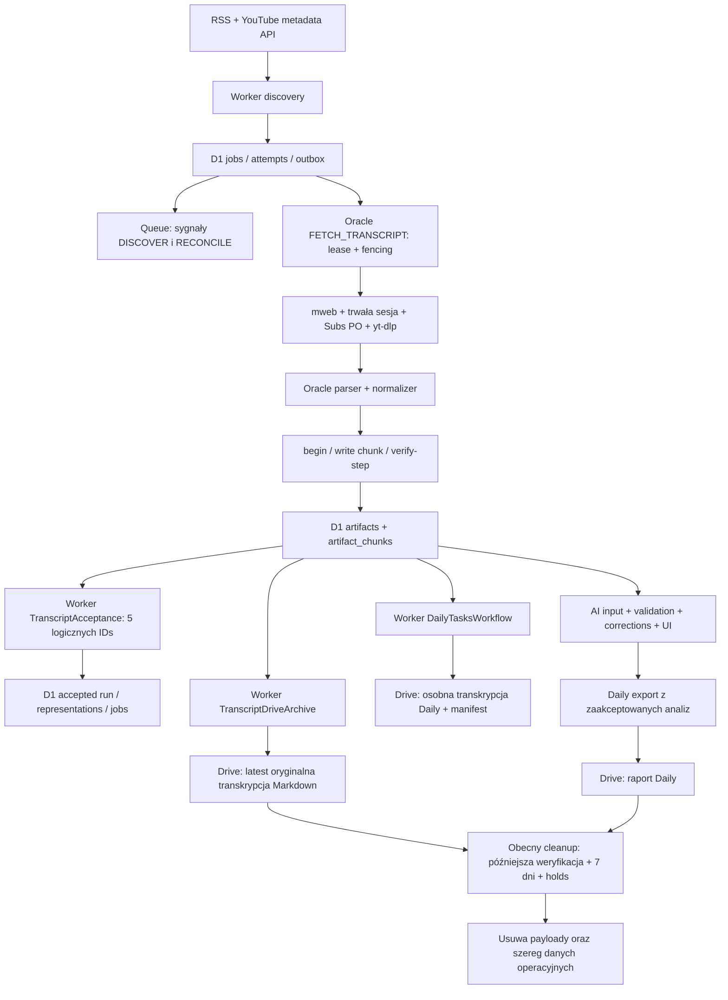

# Bartosz Intelligence — zachować transfer przez D1, wdrożyć bezstratne archiwum i bezpieczną szybką retencję

Data: **14 października 2026**, Europe/Warsaw. Rodzaj zadania: **audyt i plan implementacji**.
Repozytorium: eagleblastmusic-lgtm/bartosz-intelligence. Gałąź: **codex/remote-daily-reports**.
Badany HEAD: **ea15d283fe9097edb7deae152170f0fd86d4d527**.

## 1. Executive summary

**Rekomendacja: wariant A. Nie przenosić obecnie uploadu Drive na Oracle.** Zachować Oracle → Worker → tymczasowe payloady D1 → Drive. D1 pozostaje trwałą bazą operacyjną, a Drive docelowym archiwum pełnych transkrypcji. Usuwać wyłącznie zbędne bajty transkrypcji, możliwie od razu po bezstratnej archiwizacji, sprawdzeniu odczytu zastępczego i zwolnieniu aktywnych zależności. To rekomendacja docelowej zmiany, nie deklaracja, że obecna retencja już spełnia wymagania.

Najważniejsze ustalenia:

1. **Obecny cleanup nie jest retencją samych transkrypcji.** Usuwa także reprezentacje, evidence, obserwacje, wyszukiwanie, nagłówki artefaktów oraz redaguje accepted outcomes. UI i reprocess odmawiają pracy po takim cleanupie. Zmiana „7 dni → 0” bez zmiany semantyki złamałaby funkcje. Obecny Markdown Drive zachowuje odebrane cue i czasy, lecz nie pełny RAW ani dokładny manifest AI. Najpierw potrzebne są bezstratne archiwum techniczne i wspólny resolver. [K14] [K15] [K23]
2. **Obecny transport ma sześć payloadów, nie pięć.** Dwie mapy SEGMENT_MAP mają różne schematy i konsumentów. Lokalny replay obecnego kodu dał 269–348 kB/12–13 fragmentów w dwóch próbkach; większy zachowany materiał ma około 1,86 MB/60 fragmentów. Fragmenty mają do 32 KiB. Na film przypada 16 + 2C żądań Oracle → Cloudflare, bez okresowych heartbeatów i późniejszych odczytów. Historyczne mapy z 6 października zawyżają obecny koszt. [K02] [K03] [E03]
3. **Bezpośredni upload B daje oszczędności, lecz nie usuwa głównej luki funkcjonalnej.** Może wyeliminować 30–126 obecnych RPC artefaktowych dla zmierzonych profili, zapisy/odczyty chunków i ich base64, ale wymaga nowej finalizacji accepted source, spoolu Oracle, resumable transferu i delegowania uprawnień. Weryfikacja i odczyty AI przez Workera nadal konsumują zasoby. Nie ma pomiaru dowodzącego, że transport jest aktualnym głównym wąskim gardłem dla 30 kanałów.
4. **Scheduler trzeba poprawić obowiązkowo.** Obecne jeden skan/5 min i jeden plik archiwum/5 min rozciągają serię 30 pozycji do około 150 min. Właściciel zatwierdził pełne cykle wszystkich aktywnych kanałów o 15:00 i 23:00 Europe/Warsaw, z ograniczonymi porcjami i natychmiastową automatyczną kontynuacją. Pięciominutowy Cron może nadal obsługiwać niezależne recovery, retry i archiwizację. [K17] [K18] [K08]
5. **Nie deklarujemy autonomii całej aplikacji ani pełnego odbioru Free.** Istnieją dowody Oracle → D1 → API bez Windows dla dwóch twórców; obecna usługa Oracle uruchamia FETCH_TRANSCRIPT. Nie wykazano aktywnego Oracle ANALYZE/PROJECT ani rzeczywistego Daily AI. Brakuje CPU/memory pełnego pipeline na Workers Free, dobowej kwoty całego konta po zmianach i aktualnego wolnego miejsca Drive. [E01] [K26] [K27]

**Korzyść A:** brak nowej granicy zaufania Drive na Oracle; usunięcie sztucznego tygodnia przetrzymywania. Przy przykładowym średnim buforze 1 h zamiast 7 dni ilość rezydującego payloadu maleje o **99,4%**. To model stanu ustalonego, nie pomiar oszczędności produkcji. A nie oszczędza początkowych RPC/zapisów i dodatkowo płaci za DELETE oraz archiwum techniczne. Cel zasobowy pozostaje **0 PLN/miesiąc**, warunkowo w istniejących darmowych pulach; koszt pracy i bieżący rachunek konta nie zostały zmierzone.

## 2. Zakres, stan repo i wiarygodność dowodów

### 2.1. Repozytorium i brak zmian wykonawczych

Na początku odczytano Git HEAD, gałąź, origin i AGENTS.md. Working tree nie miało zmian śledzonych; zawierało nieśledzone materiały backupów, wdrożenia, diagnostyki Oracle/Firefox i ZIP-y. Zostały zachowane. Jedynym docelowym plikiem tego audytu jest niniejszy raport. Nie wykonano implementacji, commita, push, deploy, migracji, nowych uploadów Drive ani usunięcia danych.

Przeczytano także wcześniejszy raport znaleziony jako **C:/Users/Skarabeusz/Downloads/BARTOSZ_INTELLIGENCE_ARCHITECTURE_DECISION_2026.md**. Dotyczy tego samego HEAD, ale porównuje hybrydę z Oracle-only. Jego „wariant A/B/C” nie jest numeracją wariantów tego audytu. Wcześniejsze zalecenie RSS co 30–35 min zostało zastąpione wiążącym wymaganiem dwóch pełnych cykli o 15:00 i 23:00. Jego założenie 0,5 MB/film nie jest naszym pomiarem.

### 2.2. Oznaczenia

| Oznaczenie           | Znaczenie                                                                      |
| -------------------- | ------------------------------------------------------------------------------ |
| **POMIAR TERAZ**     | Odczyt lub izolowany replay wykonany w tym audycie; podany zakres i środowisko |
| **ZACHOWANY POMIAR** | Wcześniejszy JSON/receipt w repo; nie nowy test produkcyjny                    |
| **KOD**              | Zachowanie lub liczba operacji wyprowadzona z badanego HEAD                    |
| **MODEL**            | Jawne założenia i obliczenia, bez deklaracji produkcyjnego pomiaru             |
| **NIEZWERYFIKOWANE** | Brak wystarczającego dowodu; nie oznacza zera ani PASS                         |

Wartości SQL, wyniki SELECT, odczytane logiczne chunki, D1 rows_read/rows_written i CPU to różne miary. Liczba statements ani zwróconych rekordów nie zastępuje rozliczanych wierszy. Miesiąc w projekcjach ma 30 dni; MB = 1 000 000 B, MiB = 1 048 576 B.

### 2.3. Świeże odczyty i istniejący odbiór

| Dowód                                              | Wynik i granice                                                                                                                                                                                                                                                                                                                                        |
| -------------------------------------------------- | ------------------------------------------------------------------------------------------------------------------------------------------------------------------------------------------------------------------------------------------------------------------------------------------------------------------------------------------------------ |
| **POMIAR TERAZ**, 20:11:59 UTC / 22:11:59 Warszawa | Jedno videos.list, istniejący klucz lokalny podany wyłącznie w nagłówku: HTTP 200, 1 film, PT11M54S, 220 ms. Nominalnie 1 quota unit; zero D1/OAuth/Drive operacji. Nie porównywano wartości klucza z sekretem wdrożonym.                                                                                                                              |
| **POMIAR TERAZ**, 20:16:00 UTC / 22:16:00 Warszawa | Jeden produkcyjny SELECT pięciu ostatnich DISCOVER/RECONCILE: 1 PENDING i 4 SUCCEEDED, ostatni sukces 20:11:06.947 UTC. D1 meta: **972 rows_read, 0 rows_written, changes=0, changed_db=false**, 6,5567 ms SQL, size_after **29 925 376 B**. Żadnych payloadów ani poświadczeń w wynikach.                                                             |
| Interpretacja obu odczytów                         | Świeże SUCCEEDED potwierdzają niedawną produkcyjną pracę discovery; istniejący klucz lokalny działa dziś. Nie jest to niezależny fresh upstream probe wdrożonego sekretu: RSS304 lub domknięcie staged page mogą zakończyć zadanie bez nowego Data API request. Gap-recovery, actual quota i pełny cykl 30 kanałów nadal wymagają odbioru. [K19] [K40] |
| **ZACHOWANY POMIAR**, 14 X                         | Oracle/systemd aktywne; dwa twórcy, 241 + 306 cue, RAW/source SHA i wszystkie odebrane czasy porównane; D1 40/40 migracji. Nie jest to E2E tych samych nowych filmów aż do Drive ani 24–72 h obserwacji. [E01]                                                                                                                                         |
| **ZACHOWANY POMIAR**, 11 X                         | Drive readback 107 148 B, 1071 cue, zgodny SHA; recovery po zmianie wersji metadata. Nie jest to pomiar normalnego nowego uploadu. [E04]                                                                                                                                                                                                               |
| **ZACHOWANY POMIAR**, 12 X                         | Free Active zaobserwowane podczas osobnego Cloudflare PoC. Nie oznacza nowego sprawdzenia billing w tym audycie. [E06]                                                                                                                                                                                                                                 |

Odczyt produkcyjny użył istniejącego logowania Cloudflare; poświadczenie zostało tylko w pamięci procesu. Nie kopiowano ani zmieniano Google/YouTube cookies, refresh tokenów i sesji. Nie uruchamiano refreshDriveAccess: ta funkcja zapisuje D1 także przy odświeżeniu tokena.

## 3. Rzeczywisty przepływ pojedynczego filmu

### 3.1. Diagram obecnego rozwiązania



Queue nie przenosi pełnej transkrypcji. Trwała kolejka i accepted state są w D1. Transkrypcje przydziela Oracle przez istniejący worker RPC; nie wykonuje ich konsument Cloudflare Queue. [K01] [K02] [K17]

### 3.2. Etapy, dane i konieczne kontrakty

| Etap / wykonawca                    | Dane i operacje                                                 | Liczba / wielkość                                                                                    | Czy można pominąć?                                                                           |
| ----------------------------------- | --------------------------------------------------------------- | ---------------------------------------------------------------------------------------------------- | -------------------------------------------------------------------------------------------- |
| Discovery — Worker/D1               | RSS ID, metadata, scan cursor, item, FETCH_TRANSCRIPT/outbox    | Zależne od scan/page; oddzielone od payloadów                                                        | Nie: intake/dedup/history i dostępność publiczna muszą pozostać                              |
| Przydział — Oracle ↔ Worker ↔ D1    | Identity, admission, lease, start, input snapshot, heartbeat    | 10 stałych HTTP w udanym cyklu, plus timer heartbeat co 60 s; w tym końcowy accept                   | Nie usuwać lease/fence/admission; B/C mogą zmienić tylko payload RPC                         |
| Pobranie — Oracle                   | Oryginalny JSON3/VTT/XML i segmenty z brokera Unix socket       | Max raw wejście 4 MiB w workerze; lokalny broker ma własny limit odpowiedzi 32 MiB                   | Zachować działający silnik i klasyfikację source errors                                      |
| Przygotowanie — Oracle              | SOURCE, caption coverage, normalized anchors/offsets i hashes   | Pełne wykonanie K=6; PARTIAL K=3                                                                     | Nie zmieniać znaczenia źródła/anchorów; możliwa późniejsza fizyczna deduplikacja             |
| begin — Oracle → Worker/D1          | Typ, hash, byte_size, provenance, parent ID                     | K HTTP; 2+p SQL repo + auth na artefakt                                                              | B/C potrzebują równoważnego descriptor/remote receipt, nie braku kontraktu                   |
| write — Oracle → Worker/D1          | Chunk UTF-8 w base64url, rozmiar, SHA i lease token             | C HTTP; po 4 SQL repo + 1 auth; chunk zapisany i odczytany                                           | D1 body może zostać pominięte tylko po dodaniu równoważnej niezależnej integralności         |
| verify-step — Oracle → Worker/D1    | Podpisany checkpoint, chunki, incremental SHA                   | C HTTP; po 3 SQL repo + 1 auth; końcowe seal/get 2K SQL                                              | B/C zastępują cały dowód verified, nie tylko odpowiedź 200                                   |
| accept — Worker/D1                  | 5 różnych verified ID, raw/source/manifest identity, provenance | 21 explicit SQL w nowym udanym przypadku; bez pełnego reread tekstu                                  | Kontrakt accepted run, representations i atomowy job completion obowiązkowy                  |
| Archive — Worker/D1/Drive           | SOURCE + caption coverage lub zgodna starsza mapa → Markdown    | 4 SQL odczytu dla próbek, wszystkie chunki obu wejść; zwykle 8 Drive HTTP + 1 OAuth dla nowego pliku | Istniejący czytelny eksport zachować; potrzebuje companion exact archive przed payload purge |
| AI / UI / Daily — obecni konsumenci | SOURCE, accepted manifest, corrections, plans/results           | Zależne od realnych wywołań, nie jeden stały koszt filmu                                             | Nie pomijać; w A/B/C wspólny resolver zastępuje lokalizację bajtów                           |
| Retencja — Worker/D1                | Weryfikacja Drive, guards, DELETE/checkpoint                    | Dziś maks. 4 strony po 25 rows/tick, szeroka lista tabel                                             | Reuse guards/checkpoints, zmienić zakres na same kwalifikowane transcript chunks             |

Szczegóły implementacji i limity aplikacyjne: [K01] [K02] [K03] [K04] [K05] [K06] [K07] [K08] [K09].

### 3.3. Ile razy operujemy na tych samych bajtach

Nie jest to pomiar sprzętowych kopii pamięci, GC ani CPU; poniżej policzono logiczne przejścia kodu.

- **Oracle:** ArtifactClient hashuje cały artefakt dwukrotnie; runner osobno RAW i SOURCE; normalizer SOURCE i manifest oraz tożsamości segmentów. Splitter iteruje po Unicode, tworzy chunki UTF-8, potem base64 i JSON. NORMALIZED oraz OFFSET_MAP powtarzają informacje w głównym manifeście.
- **Worker podczas uploadu:** chunk request SHA + SHA zapisanego readback + verify chunk SHA + pełny incremental SHA: około **4B bajtów hashowanych**. Co najmniej około **4B dekodowanych z base64** i B kodowanych do zapisu. Do tego małe podpisy checkpointów, auth i manifest.
- **D1:** treść chunku zapisana raz; czytana po write i podczas verify; końcowy COUNT przegląda C wpisów indeksu. Każdy kolejny konsument czyta ją ponownie. Base64 zwiększa sam body do około 4B/3.
- **Archive Worker:** SOURCE+map czytane, dekodowane i składane; chunk+full SHA to 2 razy rozmiar obu wejść. Renderer ponownie hashuje SOURCE i Markdown. Multipart kopiuje/renderuje tekst; full Drive readback ponownie pobiera i hashuje całą zawartość.
- **Drive:** zapis pliku, pełny readback, metadata before/after i kontrola prywatności. Daily/Tasks ma drugą celową ścieżkę zapisu podobnej transkrypcji z własnym receipt; nie mylić jej z przypadkowym retry duplicate.

Write/readback i końcowy verify są obecnie niezależnymi częściami dowodu integralności. Podział 32 KiB rozkłada incremental hashing pomiędzy invocation i utrzymuje rekord daleko poniżej limitu D1. Można później ograniczyć duplikaty fizyczne, ale zachować IDs/hashes i dowód odczytu. [K02] [K03] [K09] [K12]

## 4. Artefakty i rzeczywista mapa zależności

### 4.1. Transkrypcyjny zestaw

| Producent → kind / schema                                    | Zawartość                                                              | Konsumenci                                                                               | Bezpieczny kierunek                                                |
| ------------------------------------------------------------ | ---------------------------------------------------------------------- | ---------------------------------------------------------------------------------------- | ------------------------------------------------------------------ |
| Oracle parser → RAW / caption-payload:1                      | Dosłowna odpowiedź providera, control events, raw SHA                  | Acceptance/provenance/audyt i replay parsera                                             | Exact bytes Drive; nie odtwarzalne z tekstu cue                    |
| Oracle parser → SOURCE_ORIGINAL / decoded-cue-text:1         | Pełny odebrany tekst cue LF, bez normalizacji                          | AI preparation/preview/validation, UI, corrections, translation, obie transkrypcje Drive | Exact bytes + descriptor/hash w D1; wspólny resolver               |
| Oracle przed normalizerem → SEGMENT_MAP / caption-coverage:1 | Cue index, offsets SOURCE UTF-16, start/end ms, source hash            | Archive także przy PARTIAL lub błędzie normalizacji                                      | Zachować osobno dla PARTIAL; dla FULL możliwa sprawdzona projekcja |
| Oracle normalizer → NORMALIZED / normalized-source:1         | Anchor text LF                                                         | Obowiązkowy osobny verified ID w acceptance                                              | Informacja w manifeście; projekcja tylko po exact hash regression  |
| Oracle normalizer → SEGMENT_MAP / segment-map:1              | Anchors, tekst, IDs/aliases, offsets, coverage, timing, source/version | Główny kontrakt AI, long input, translation, validation/evidence, Daily enrollment       | Zachować dokładny JSON każdej accepted rewizji                     |
| Oracle normalizer → OFFSET_MAP / offset-map:1                | segment_id + offsets                                                   | Wymagany ID w acceptance i metadata optional AI                                          | Informacja w anchors manifestu; nie kasować logicznego kontraktu   |
| Owner source correction → NORMALIZED + SEGMENT_MAP           | Poprawione źródło, authorship, original_ref                            | Corrected accepted authority, AI/reprocess                                               | Osobny immutable exact archive dla każdej rewizji                  |

Przy FULL runner tworzy **6** fizycznych artefaktów, lecz acceptance przyjmuje **5** IDs. PARTIAL zapisuje RAW+SOURCE+caption coverage, bez normalizacji i akceptacji jako kompletny input AI. Wyboru retencji nie można opierać tylko na kind: NORMALIZED bywa także poprawionym źródłem lub chunk-plan, a RAW także odpowiedzią AI. [K02] [K05] [K10] [K11]

### 4.2. Pozostałe zależności

| Producent → dane                                                                   | Konsument / autorytatywny kontrakt                                   | Co pozostaje w D1                                                                     |
| ---------------------------------------------------------------------------------- | -------------------------------------------------------------------- | ------------------------------------------------------------------------------------- |
| TranscriptAcceptance → accepted run, source representation, job/attempt completion | Source selection, dedup, provenance, kontrola hash, Daily enrollment | Całe immutable accepted outcome, hash, role/język/provider, job history               |
| AI preparation → chunk-plan:1 / NORMALIZED                                         | Long-input compiler/completion                                       | Plan i referencje; nie obejmować kasowaniem source payloadów                          |
| AI → RAW/provider response + ANALYSIS_CANDIDATE canonical                          | Worker validation, canonical UI, optional tasks, Daily               | Canonical wynik i input/prompt/routing snapshots lub osobny sprawdzony exact resolver |
| AI validation/enrichment → evidence, observations, links                           | Knowledge ledger/timeline, evidence UI, search, Daily                | Te struktury operacyjne zachować                                                      |
| Search producer → search_documents / FTS                                           | Wyszukiwanie tytułów, summary, insights/entities/aliases             | Indeks pozostaje; obecnie nie indeksuje całej transkrypcji                            |
| TranscriptDriveArchive → latest .md + receipt                                      | Link UI i dotychczasowa kontrola retencji                            | Folder, file ID, source/map/hash/version/privacy receipt                              |
| DailyTasksWorkflow → własna .md transkrypcja + _manifest.md, daily_drive_files     | External Daily AI/import                                             | Membership, exact source/map refs, statusy, receipts                                  |
| DailyExport → snapshot canonical analiz / bloki / raport                           | Daily UI, Drive summary, append/conflict                             | Historia i wyniki; nie usuwać w ramach source eviction                                |
| Backup → canonical inventory/restore                                               | Odtworzenie metadanych i exact archive locatorów                     | Nowe lokalizacje i pins w inventory; restore rozróżnia local/remote payload           |

Odnaleziono bezpośredni SELECT artifact_chunks w optional translation validation poza wspólnym repozytorium. Sam fallback w readVerifiedText nie wystarczy — ten konsument również musi przejść przez resolver. [K11] [K12] [K13] [K16] [K22] [K24]

### 4.3. Obecny Markdown a zgodność

Renderer sprawdza hash źródła i coverage, wycina dokładne UTF-16 slices, zapisuje cue/czasy/upstream_index i wymaga odtworzenia pełnego pozyskanego źródła. Jednak **nie zawiera RAW, exact normalized manifest, wszystkich offsets/IDs ani corrected revisions**. Nie istnieje jego parser zamieniający plik z Drive w dotychczasowy paginowany artifact API. [K07]

Dodatkowo transcript_archives jest receipt per owner/item. Po nowym SOURCE aktualizuje ten sam plik Drive. To widok latest, a nie immutable magazyn wszystkich accepted source revisions. Dla zgodności wcześniejszych accepted rekordów trzeba zachować dokładne bajty i mapping per artifact/revision; latest .md może pozostać widokiem użytkownika. [K08] [K25]

## 5. Koszt pojedynczej transkrypcji i projekcje

### 5.1. Lokalne pomiary obecnego kodu

**POMIAR TERAZ:** replay bieżących parsera/normalizatora/splittera na zachowanych publicznych danych, Node na Windows, bez nowych źródłowych żądań, D1 i Drive zapisów.

| Artefakt bytes / chunks             |  TED uEztHu4NHrs |      aircAruvnKk |         rUhllpnYWR8 |
| ----------------------------------- | ---------------: | ---------------: | ------------------: |
| RAW                                 |       33 217 / 2 |       46 010 / 2 |       807 747 / 25* |
| SOURCE_ORIGINAL                     |        9 876 / 1 |       18 430 / 1 |          39 736 / 2 |
| caption coverage                    |       21 503 / 1 |       25 829 / 1 |          98 268 / 3 |
| NORMALIZED                          |        9 876 / 1 |       18 430 / 1 |          39 736 / 2 |
| normalized SEGMENT_MAP              |      154 145 / 5 |      190 458 / 6 |        688 552 / 22 |
| OFFSET_MAP                          |       40 678 / 2 |       48 546 / 2 |         182 534 / 6 |
| **B / C**                           | **269 295 / 12** | **347 703 / 13** | **1 856 573 / 60*** |
| Same base64 chunk bodies            |          359 063 |          463 609 |    około 2 475 451* |
| Artifact HTTP                       |               30 |               32 |                 126 |
| Acquisition HTTP bez timer          |               40 |               42 |                 136 |
| Artifact SQL incl auth              |              142 |              151 |                 574 |
| Bazowe mutations headers/chunks     |               24 |               25 |                  72 |
| Archive SOURCE+coverage chunk reads |                2 |                2 |                   5 |
| Markdown z testowymi metadata       |           25 660 |           37 004 |             107 051 |
| Cue count / koniec ostatniego cue   |  241 / 13,18 min |  286 / 18,43 min |    1071 / 40,24 min |

Gwiazdka: RAW trzeciego filmu jest rozmiarem z zachowanego production receipt, nie odczytanym teraz raw plikiem. Reszta została odtworzona z exact SOURCE i zachowanej coverage; źródłowy hash zgodny. Base64 trzeciego RAW estymuje granice chunków; Unicode-safe split może dodać kilka bajtów. Koniec ostatniego cue **nie jest dowodem długości całego filmu**.

Jednorazowy wall-time normalizer replay wyniósł około 65/108/258 ms. Nie jest to CPU Workera ani benchmark ARM64. Źródła wejściowe: persistent-auth/evidence/success-ted-caption.raw, success-first-caption.raw oraz zachowany lokalny source-smoke-rUhllpnYWR8 SOURCE/manifest. Hash większego source potwierdza [E03]; bieżącą mapę 688 552 B niezależnie potwierdza [E05].

Starszy accepted film z 6 X miał **7 542 392 B / 233 chunks / K=5**, w tym mapy 3,58 MB i 3,07 MB. Bieżące scalanie literal offsets już ograniczyło ten koszt. Nie przypisujemy istniejącej redukcji około 75,4% proponowanej migracji. [K10] [E03] [E05]

### 5.2. Model operacji z kodu

Niech K=6, P=4 artefakty z original_ref, C=sum rzeczywistych chunk_count, B=sum byte_size.

```text
Artifact RPC HTTP          = K + 2C = 6 + 2C
Acquisition HTTP           = 10 + K + 2C + timer heartbeats = 16 + 2C + H
Artifact SQL incl auth     = 5K + P + 9C = 34 + 9C
Source acceptance SQL      = 21 w nowym udanym przypadku
Bazowe artifact mutations  = K inserts + C chunk inserts + K seals = C + 12
Chunk/data/index odczyty   >= 3C (write readback + verify + seal COUNT)
R0 strukturalne lookups    = 3K + P + 9C = 22 + 9C
Eviction samych chunks     = dodatkowo C bazowych DELETE
Base64 stored/wire body    ~= 4B/3, plus metadata i JSON
```

**R0 i W0 nie są billed rows.** R0 to policzone logiczne lookupy/chunk index accesses; joins, guards, triggers i skany mogą znacząco zwiększyć wynik. W0=C+12 to mutations tabel przed indeksami. Rozmiar wire body jest większy niż base64 przez JSON/provenance; nie zmierzono łącznego TLS/HTTP narzutu. Nie wyznaczamy actual Workers CPU na film.

Przykład wpływu indeksów: artifact_chunks ma compound PK i indeks retention, więc insert/delete utrzymuje dodatkowe struktury; artifacts ma PK, UNIQUE i indeksy parent/item/verified source. Uproszczony model maintenance tych indeksów daje około **3C+43 zapisów uploadu oraz 3C DELETE**, czyli około **6C+43** na pełny lifecycle. Wyprowadzenie: 6 headers × (base row + PK + 2 UNIQUE + item index + parent index) = 36; 6 seals i jeden wpis SOURCE do partial verified-source index dają kolejne 7; każdy chunk insert/delete obejmuje base row + PK + retention index. To estymacja schematu, nie wynik meta, i nie obejmuje jobów, acceptance, OAuth, archive receipts, AI, search ani backupu. Przy P180×30 to około 47 370 writes/dzień przed pozostałymi modułami — właśnie dlatego nie można ogłosić Free PASS z samych W0. [K03] [K04] [K25] [K37] [K38] [S02]

Dalsze odczyty:

- Generic readVerifiedText: 1+2c SQL na artefakt, hash chunków i całego body.
- Oracle ArtifactClient.readText: 1+c HTTP i 2+3c SQL z auth; Oracle składa całość i sprawdza SHA.
- UI owner page: do 4 chunks, 2 SQL/page, base64 i SHA.
- Specjalny archive reader: 1+ceil(c/64) SQL/artefakt. Dla SOURCE+coverage próbek: 4 SQL; odczyt wszystkich ich chunk rows pozostaje.
- B/C nie usuną tych kosztów AI/preview/UI, jeśli Cloudflare nadal ma pobierać i walidować pełne źródło z Drive. Zmienia się miejsce i liczba round-trip, nie konieczność dowodu. [K03] [K06]

### 5.3. Profile 15, 60 i 180 minut — bez przeliczania minut na bajty

Nie ma reprezentatywnego pomiaru sześciu obecnych artefaktów dla dokładnie 60 i 180 min. Przyjęto **niezależne scenariusze rozmiaru**, przypisane do wymaganych klas do planowania; nie wynikają z proporcji czasu i nie są maksimum:

| Profil                                              |      RAW |  SOURCE | Coverage | NORMALIZED |  Manifest |   OFFSET |             B / C |
| --------------------------------------------------- | -------: | ------: | -------: | ---------: | --------: | -------: | ----------------: |
| **P15**, pomiar zbliżony: TED, cue koniec 13,18 min | 33 217 B | 9 876 B | 21 503 B |    9 876 B | 154 145 B | 40 678 B |    269 295 B / 12 |
| **P60**, założony profil 2 MiB                      |  768 KiB |  64 KiB |  192 KiB |     64 KiB |   768 KiB |  192 KiB |  2 097 152 B / 64 |
| **P180**, założony profil 8 MiB                     |    3 MiB | 256 KiB |  768 KiB |    256 KiB |     3 MiB |  768 KiB | 8 388 608 B / 256 |

Dłuższy film może mieć mało mowy, a krótszy gęste rolling captions i duży RAW. Każdy profil może wystąpić przy innej długości. C=64/256 w założonych profilach zakłada pełne granice 32 KiB; rzeczywiste granice Unicode-safe mogą zwiększyć count, w tym profilu do około jednego dodatkowego chunku na artefakt. Obowiązkowy przyszły pomiar powinien objąć rzeczywiste 15/60/180 min, manual i generated, języki i timestamp gaps; nie wolno uznać tych założeń za ich rozkład.

### 5.4. Dzienne i miesięczne payloady/operacje

3/9/30 nowych filmów dziennie to 90/270/900 za 30 dni. Zakładamy jeden nowy FULL source, bez failed attempts/reuploadów, corrections i AI. Poniżej **obecny transport**, nie cały koszt aplikacji.

| Profil | Filmy/dzień | B MB/dzień / 30 dni | Artifact HTTP/dzień / 30 dni | SQL artefaktów/dzień / 30 dni |
| ------ | ----------: | ------------------: | ---------------------------: | ----------------------------: |
| P15    |           3 |        0.81 / 24.24 |                    90 / 2700 |                   426 / 12780 |
| P15    |           9 |        2.42 / 72.71 |                   270 / 8100 |                  1278 / 38340 |
| P15    |          30 |       8.08 / 242.37 |                  900 / 27000 |                 4260 / 127800 |
| P60    |           3 |       6.29 / 188.74 |                  402 / 12060 |                  1830 / 54900 |
| P60    |           9 |      18.87 / 566.23 |                 1206 / 36180 |                 5490 / 164700 |
| P60    |          30 |    62.91 / 1 887.44 |                4020 / 120600 |                18300 / 549000 |
| P180   |           3 |      25.17 / 754.97 |                 1554 / 46620 |                 7014 / 210420 |
| P180   |           9 |    75.50 / 2 264.92 |                4662 / 139860 |                21042 / 631260 |
| P180   |          30 |   251.66 / 7 549.75 |               15540 / 466200 |               70140 / 2104200 |

Do HTTP acquisition dodać 10N/dzień, czyli 300N/miesiąc, oraz timer heartbeat. Do SQL dodać 21N acceptance statements oraz zmierzyć kontrolę zadań, archive, AI i inne moduły. Rows nie wynikają z kolumny SQL.

| Profil | Filmy/dzień | R0/dzień / 30 dni | W0/dzień / 30 dni | W0 + DELETE chunks/dzień / 30 dni |
| ------ | ----------: | ----------------: | ----------------: | --------------------------------: |
| P15    |           3 |       390 / 11700 |         72 / 2160 |                        108 / 3240 |
| P15    |           9 |      1170 / 35100 |        216 / 6480 |                        324 / 9720 |
| P15    |          30 |     3900 / 117000 |       720 / 21600 |                      1080 / 32400 |
| P60    |           3 |      1794 / 53820 |        228 / 6840 |                       420 / 12600 |
| P60    |           9 |     5382 / 161460 |       684 / 20520 |                      1260 / 37800 |
| P60    |          30 |    17940 / 538200 |      2280 / 68400 |                     4200 / 126000 |
| P180   |           3 |     6978 / 209340 |       804 / 24120 |                      1572 / 47160 |
| P180   |           9 |    20934 / 628020 |      2412 / 72360 |                     4716 / 141480 |
| P180   |          30 |   69780 / 2093400 |     8040 / 241200 |                    15720 / 471600 |

B/C mogłyby uniknąć tych body operacji, ale zachowają metadane i dodadzą finalization/receipt queries. Powyższe liczby **nie są obietnicą równych oszczędności billed rows**.

### 5.5. Storage D1 i szybka retencja

Poniższy model obejmuje **same bodies base64**, bez SQLite pages/indexów, deskryptorów i innych funkcji. Obecna produkcyjna obserwacja rozmiaru całej bazy: 29,93 MB. Budżet jednej bazy Free to 500 MB; suma wolnego budżetu nie jest gwarancją miejsca na same payloady.

| Profil | Filmy/dzień | Payload base64 za 30 dni bez purge, MB | 7 dni kolejnych verified danych, MB | Średnio 1 h bufora, MB |
| ------ | ----------: | -------------------------------------: | ----------------------------------: | ---------------------: |
| P15    |           3 |                                  32.32 |                                7.54 |                   0.04 |
| P15    |           9 |                                  96.95 |                               22.62 |                   0.13 |
| P15    |          30 |                                 323.16 |                               75.40 |                   0.45 |
| P60    |           3 |                                 251.66 |                               58.72 |                   0.35 |
| P60    |           9 |                                 754.97 |                              176.16 |                   1.05 |
| P60    |          30 |                               2 516.58 |                              587.20 |                   3.50 |
| P180   |           3 |                               1 006.63 |                              234.88 |                   1.40 |
| P180   |           9 |                               3 019.90 |                              704.64 |                   4.19 |
| P180   |          30 |                              10 066.33 |                            2 348.81 |                  13.98 |

1 h to ilustracja średniego residence time dla równomiernego dopływu i terminowo działającego archive/eviction. **Nie jest TTL ani gwarancją.** Kolejka, AI pins, błąd Drive czy outage wydłużają bufor. Burst 30×P180 wymaga około **335,5 MB samych bodies**, a z istniejącą bazą około 365,5 MB przed innymi narzutami. Nie wolno zakładać, że każdy taki burst jest bezpieczny bez admission i zmierzonego size_after.

Porównanie 7 dni do 1 h daje 99,4% redukcji średniego payload storage. Jednak dzisiejsze 7 dni są dolną granicą po późniejszej weryfikacji, a deletion jest osobno gated; bez aktywacji i wszystkich warunków dane mogą pozostać dłużej lub bez końca. **Nie zmierzono faktycznego siedmiodniowego steady-state produkcji.**

DELETE kosztuje writes. W SQLite zwolnione pages mogą zostać użyte przez następne INSERT, ale fizyczny plik nie musi się natychmiast zmniejszyć. Nie znaleziono w sprawdzonych D1 SQL docs gwarancji dostępnego VACUUM ani natychmiastowego fizycznego shrink po eviction. Nie planować migracji bazy/compaction jako rutynowego audytu. Kontrolować logical bytes, rows/meta.size_after i provider file_size; kwalifikować reclaim/reuse na izolowanym D1, później w odrębnie autoryzowanym odbiorze. Time Travel Free zachowuje historię do 7 dni niezależnie od aplikacyjnego purge. [S01] [S02] [S07]

### 5.6. Tło 30 kanałów i dwóch cykli

**Docelowe, zgodne z właścicielem:** 60 channel checks/dzień, 1800/30 dni. RSS ma aplikacyjny limit 64 000 B, więc max odebrany body tych 60 feedów to 3,84 MB/dzień /115,2 MB/miesiąc; rzeczywiste feedy zwykle mniejsze, a 304 nie gwarantowane. Przy najwyżej jednym metadata batch/channel check: do 60 videos.list/dzień /1800/miesiąc, plus bounded gap-recovery pages i refresh. videos.list i playlistItems.list kosztują po 1 unit; rzeczywiste quota projektu sprawdzić osobno. Nie używać search do normalnego RSS recovery. [K19] [S12]

Istniejący zdrowy idle executor: heartbeat + admission + lease co około 30 s, do **8640 HTTP/dzień /259 200 miesięcznie**, około 2880 session upsert/dzień. Jest to górny model idle, niższy podczas pracy/awarii. A/B/C tego tła nie eliminują. Dodatkowo obecny Cron ma 288 uruchomień/dzień /8640/miesiąc; są to invocation schedulera, nie 288 nowych transcript payloadów.

Przy 30 filmach/dzień P15/P60/P180 same acquisition HTTP wynoszą 1200/4320/15 840 dziennie; z pełnym idle modelem sumy orientacyjne 9840/12 960/24 480 przed UI, AI, innymi workerami i retry. Nie kwalifikuje to CPU, D1 lub Queue. Typowo dostarczenie małego sygnału Queue kosztuje 3 operations; 60 scan jobs + N FETCH wake-up hints to model 189/207/270 operations/dzień, **przed** kontynuacjami, dodatkowym dispatcherem/recovery i AI. Nie jest to pomiar wszystkich messages.

Historyczny 9 X wynik 5 507 234 account rows_read i 11 178 rows_written pokazał realne wyczerpanie DAILY READ. Zidentyfikowane indeksy/scany zostały już poprawione; w 14 X schema evidence zawiera odpowiednie indeksy. Nie przedstawiamy starego 5,5 mln jako dzisiejszego normalnego zużycia. Lokalny dowód optymalizacji admission 1508→4 reads i backup 269699→31184 jest wcześniejszym konkretnym benchmarkiem. Brakuje obecnego pełnego dnia account usage. [E07] [E08]

## 6. Aktualne limity darmowe i zasoby

Źródła oficjalne sprawdzono online 14 X 2026. Ich limity nie dowodzą konfiguracji ani niewykorzystanej puli konkretnego konta.

| Platforma                                     | Aktualny limit / reguła                                                                                                                                                                      | Znaczenie                                                                                                               |
| --------------------------------------------- | -------------------------------------------------------------------------------------------------------------------------------------------------------------------------------------------- | ----------------------------------------------------------------------------------------------------------------------- |
| Workers Free                                  | 100 000 incoming requests/dzień; 10 ms CPU/invocation HTTP i Free Cron; 128 MB/isolate                                                                                                       | CPU jest limitem pojedynczego invocation, a pamięć współdzielona między równoległymi żądaniami isolate                  |
| Worker HTTP                                   | Brak hard wall limit przy podłączonym kliencie; waitUntil do 30 s po odpowiedzi/disconnect; Cron i Queue wall do 15 min                                                                      | Nie zakładać 15 min CPU Free ani trwałości niezakończonego transferu                                                    |
| Worker subrequests/body                       | Free 50 external/request; internal services 1000, ale D1 osobno 50 queries/Free invocation; 6 jednoczesnych connections; request body Free account 100 MB, response bez wymuszonego body cap | Mniejsze limity aplikacji nadal obowiązują; redirects kosztują subrequests                                              |
| Cron/Queue                                    | 5 Cron triggers Free; Queues 10 000 operations/dzień; message do 128 KB; accounting po 64 KB; Free retention 24 h                                                                            | Trwały backlog D1 przeżywa utratę hintów; nie przesyłać artefaktów Queue                                                |
| D1 Free                                       | 5 mln rows_read/dzień; 100 000 rows_written/dzień; 500 MB/baza, 5 GB/konto; 10 baz                                                                                                           | Dzienne limity konta reset 00:00 UTC; Free po przekroczeniu przerywa queries, nie automatycznie płatne rozszerzenie     |
| D1 query/row                                  | 50 statements/invocation Free, także w batch; string/BLOB/row do 2 000 000 B, SQL 100 KB, 100 bind params, query do 30 s                                                                     | Nie pakować pełnych map jako jeden rekord; batch nie obchodzi limitu statements                                         |
| Oracle A1 Always Free — **obecna publikacja** | 1500 OCPU-h i 9000 GB-h/mies. (~2 OCPU/12 GB); 200 GB boot+block, 10 TB outbound/mies.                                                                                                       | Nie używać historycznego 4/24 jako aktualnego publicznego przydziału; pula dotyczy konta                                |
| Oracle istniejąca VM — **dowód 13 X**         | A1, 1 OCPU/6 GB/1 Gbps; wolne około 42,27 GB root                                                                                                                                            | Bez zmiany shape; pełne billing/quota tenancy nie sprawdzone                                                            |
| Oracle idle reclaim                           | Możliwy po 7 dniach niskiego p95 CPU/network i RAM                                                                                                                                           | Always Free nie daje gwarancji bezawaryjnego hosta; potrzebny restore istniejącego systemu                              |
| Drive API — nowy model                        | Od 1 V 2026: 1 mln quota units/project/min, 325 tys./user/project/min; 400 mln/day billing threshold, egress 1 TB/day                                                                        | Projekty używające API XI 2025–IV 2026 zachowują stare quotas; wiek/limity naszego projektu nie ustalone                |
| Drive upload/storage                          | Workspace reguła 750 GB/user/day; plik do 5 TB; osobiste free 15 GB wspólne z Gmail/Photos                                                                                                   | Reguły Workspace nie zastępują ograniczenia konsumenckiej pojemności. Actual storageQuota wolnego miejsca nie odczytano |
| Drive resumable                               | Session expiry po tygodniu; chunk wielokrotność 256 KiB poza ostatnim; 308+Range/status PUT; session 404 wymaga restartu                                                                     | Obecny klient używa buffered multipart, nie resumable                                                                   |
| OAuth                                         | drive.file + openid; Testing grant z Drive może wygasnąć po 7 dniach                                                                                                                         | Production grant też może zostać revoked/invalid_grant; nie obiecywać wieczystej sesji                                  |

Źródła: [S01] [S02] [S03] [S04] [S05] [S06] [S08] [S09] [S10] [S11] [S14] [S15] [S16]. Generic Queues docs pokazują także CPU 30 s/default i do 5 min; nie stosować tej ogólnej/Paid wartości jako uprawnienia CPU konta Free wobec jego 10 ms/invocation. Oficjalna strona Drive mówi, że standardowe użycie nie ma dodatkowych opłat; ponadprogowe billing zapowiedziano na później w 2026 z co najmniej 90 dniami notice. Faktyczne quota i aktualny stan billing naszego projektu pozostają niezweryfikowane. [S08]

**Oracle obciążenie źródła:** zachowany pomiar dwóch capture dał około 17,5–18,3 s wall, 4,93–5,15 CPU s i 385–388 MiB peak process tree RSS. Pięć recorded source request bodies to około 6,55–6,59 MB/capture; nie jest to kompletny network capture wszystkich assets. Proces źródłowy ma 768 MiB, CPU 50%, swap 0, concurrency 1. Przy N=3/9/30 podobnych filmach sam model capture CPU to około 15/45/150 s/dzień i 450/1350/4500 s/miesiąc; wall około 54/162/540 s/dzień. Nie przenosimy tego pomiaru na 180-min generated captions. [E01] [K28]

Dla 30 nowych materiałów/dzień model źródłowych received bodies to około 0,197 GB/dzień /5,9 GB/miesiąc, plus niepoliczone assets. Transport wszystkich P180 artefaktów do API to około 0,336 GB/dzień /10,07 GB/miesiąc. To daleko poniżej 10 TB outbound, lecz inbound/other tenancy traffic i free eligibility są osobnymi miarami. B zastąpiłby wysyłanie base64 do API uploadem bytes/bundle do Drive; nie uzasadnia większej VM. Niezależny Worker readback nadal istnieje.

**Pojemność Drive:** model lossless sidecar JSON z exact base64 wszystkich payloadów + czytelny Markdown ma rozmiar około 4B/3 + Markdown + descriptors. Dla N=30 odpowiada minimum około 0,323/2,517/10,066 GB miesięcznie bodies dla P15/P60/P180, przed Markdown, corrected revisions, backupami i istniejącym Gmail/Photos. Nie ma darmowego nieograniczonego archiwum. Sama standardowa pula 15 GB nie dowodzi dostępności nawet kolejnego miesiąca P180. Przed production eviction obowiązkowo sprawdzić storageQuota i realny przyrost, bez kupowania nowej usługi.

## 7. Warianty A/B/C

### 7.1. Porównanie

| Kryterium         | **A — istniejący bufor D1 + szybka bezpieczna retencja**                          | **B — Oracle → Drive**                                                                  | **C — Oracle → Worker → Drive, bez D1 body**                                                  |
| ----------------- | --------------------------------------------------------------------------------- | --------------------------------------------------------------------------------------- | --------------------------------------------------------------------------------------------- |
| HTTP Oracle → CF  | Obecne 16+2C+H; odczyty AI nadal                                                  | Metadata/lease + initiate/finalize; usuwa K+2C artifact RPC, ale dodaje nowy protokół   | Metadata/lease + T upload parts + finalize; T zależy od rozmiaru/chunk, nie magiczne 1        |
| Drive/OAuth       | Obecny .md: 8+1; dodatkowy exact archive ma własne transfer/readback              | Worker reserve/session/verify; Oracle PUT/status; bez kopiowania refresh tokena         | Worker token/session/PUT/readback; bytes przechodzą CF, nawet bez D1                          |
| D1 read/write     | Początkowe C chunks, verify i potem C DELETE; pozostaje metadata                  | Bez body insert/read/delete; metadata i independent finalization zostają                | Podobna eliminacja body jak B; więcej transfer checkpoints niż prosty single upload           |
| D1 storage        | Temp około 4B/3 per niewyeksportowany/pinned film; docelowo tylko operational     | Body 0 po poprawnym commit; Oracle spool do potwierdzenia                               | Body 0; potrzebny spool Oracle do potwierdzenia                                               |
| Worker CPU        | Obecny bounded chunk hashing + archive/render/readback; A nie usuwa tych operacji | Usuwa uploadowe około 4B SHA/base64 passes, ale pozostawia full verification/AI/UI      | Native streaming może ograniczyć base64; verify i downstream nadal. Buffered całość ryzykowna |
| Oracle            | Obecne normalize + K+2C RPC; po accepted może wykonywać następny film             | Transfer/metadata, durable spool, resume i journaling; obecny 180 s cycle wymaga zmiany | Podobny spool/lease, transfer przez nowy endpoint                                             |
| Network           | API dostaje base64; D1 readback; CF → Drive + Drive → CF                          | Oracle → Drive bytes; Drive → CF independent verifier i AI                              | Oracle → CF → Drive bytes + readback; brak oszczędności transportu na CF do zera              |
| Recovery          | Trwała poprawna kopia D1 w czasie Drive outage                                    | Bez spoolu restart może zgubić jedyną pozyskaną kopię; spool i fixed ID obowiązkowe     | Te same ryzyka po utracie połączenia klienta/Worker invocation                                |
| Secrets           | Existing Worker OAuth; Oracle wyłącznie executor credential                       | Nowa capability boundary; zwykły access token daje zbyt szeroki dostęp                  | Secrets nadal Worker; nowy payload endpoint wymaga ochrony owner/lease                        |
| Repo delta        | Wspólne exact archive + resolver + payload-only cleanup + scheduler               | Wszystko wspólne + remote acceptance + capability + Oracle spool/transfer               | Wszystko wspólne + streaming API + resumable checkpoints + remote acceptance                  |
| Funkcje AI/UI     | Zmiana resolvera/policy konieczna przed purge                                     | Sama migracja uploadu ich nie zachowuje                                                 | Sama zmiana storage ich nie zachowuje                                                         |
| Miesięczne zasoby | Cel 0 PLN pod limitami; nie jest bezkosztowy CPU/writes                           | Także potencjalnie 0 PLN; brak oszczędności rachunku 0→0                                | Także potencjalnie 0 PLN; Free wykonalność wymaga pomiaru                                     |
| Eksploatacja      | Najwięcej reuse, trwały bufor i istniejąca granica OAuth                          | Więcej stanów transferu i odzyskiwania na VM                                            | Więcej endpointów/checkpointów; awarie CF przerywają transfer                                 |

Wspólne A/B/C wymagają zachowania lossless accepted source, Drive reader, metadata, provenance i reguł pins. Koszt tych elementów nie jest „kosztem tylko A”.

### 7.2. Czy C jest wykonalny na Workers Free?

**Technicznie tak dla odpowiednio ograniczonego, strumieniowego protokołu; obecny kod nie stanowi takiego dowodu.** Limity transportu 100 MB i 128 MB nie są głównym problemem małych próbek, ale cały buffered multipart, parsed maps i readback mają kilka jednoczesnych kopii. Obecny max32MiB nie jest gwarancją memory-safe. SOURCE/coverage read może mieć mało SQL, a mimo to przekroczyć CPU przez parsing/render/hash. [K09]

Bezpieczna konstrukcja C: Oracle przygotowuje exact bytes, Worker autoryzuje małą część transferu, streamuje ją do przypiętej resumable session i zapisuje mały checkpoint; finalizacja niezależnie weryfikuje całość pod fence. Nie parsować wszystkich map ani wykonywać pełnego custom SHA wielomegabajtowego bundle w tym samym 10 ms invocation. Zastosować istniejące bounded/hash checkpoints. Jeden Worker request nie zapewnia trwałego resume: disconnect/waitUntil/runtime restart wymaga recovery.

Dla przykładowych 256 KiB upload parts T≈2/11/43 dla base64 capsule P15/P60/P180 (plus metadata, końcowa część i verification). To **model nowego protokołu**. D1 checkpoints i CPU każdej części trzeba zmierzyć. C zachowuje prostsze umiejscowienie sekretów niż B, ale dodatkowo pośredniczy w każdej części payloadu, więc nie jest automatycznie lepszy.

### 7.3. Ile A oszczędza, a ile mogłoby B

**A wprost:** początkowe artifact HTTP/rows nie maleją. Redukcja jest w residence/storage i późniejszych niepotrzebnych D1 rereads po przełączeniu konsumentów; DELETE i technical archive dodają pracę. Nie ma uczciwej liczby „X% Workers CPU” z dostępnych pomiarów.

**B potencjalnie, measured profiles:** usunięcie 30/32/126 artifact RPC na film, czyli 900/960/3780 dziennie przy 30 filmach. Po dodaniu start/finalize/RPC i verification oszczędność netto jest mniejsza. Dla większej zachowanej próbki uniknięcie 72 bazowych artifact mutations + 60 późniejszych DELETE per film dotyczy body/header lifecycle; headers wymagane zdalnie pozostaną, więc nie wszystkie 132 mutations znikają. B unika przede wszystkim **60 chunk INSERT + 60 DELETE**, chunk indexes oraz uploadowe readbacks. Nie można utożsamiać tego z 132 billed rows.

**P60/P180 stress przy 30/d:** obecne artifact HTTP 4020/15540 dziennie; P180 stanowi materialny koszt, ale jest scenariuszem, nie zmierzonym profilem wszystkich kanałów. B/C eliminują 1920/7680 chunk INSERT i tyle samo DELETE dziennie; każda operacja ma dodatkowe indeksy. Maksymalny benefit nie obejmuje kontrolnego baseline 8640 HTTP/d, AI, exact remote readback ani innych D1 scans. Decyzję o późniejszym B podjąć dopiero przy dowodzie przekroczeń/dużej proporcji kosztu transportu po obowiązkowym schedulerze i A, nie na podstawie liczby kanałów.

## 8. OAuth i najbezpieczniejsze uwierzytelnianie

Refresh tokeny są w **D1 drive_credentials.envelope_json**, AES-256-GCM. AAD wiąże owner, connection, Google subject i OAuth client; losowy IV96 i tag128. Wrapping key i Google client secret są w konfiguracji sekretów Workera/recovery poza D1. Klucz AES importowany jako nieeksportowalny; brak fallbacku do session signing key. [K20] [K21]

OAuth: offline consent, PKCE S256, jednokrotny state/nonce/browser intent, owner/OIDC identity i sprawdzenie scope. Access token powstaje i pozostaje w pamięci Workera. refreshDriveAccess wysyła fixed-origin token POST, aktualizuje credential/connection w D1 pod revision guards, ponownie szyfruje ewentualną rotację refresh tokena. invalid_grant oznacza REAUTH_REQUIRED, a transient network nie oznacza braku napisów. [K20]

Zachowany production-grant-renewal.json z 8 X potwierdza zaszyfrowane credentials, independent refresh PASS i verified root; tryb Production jest OWNER_CONFIRMED, a obserwacja długoterminowa NOT_YET_MATURE. To dowód istniejącej konfiguracji, nie fresh sprawdzenie ważności grantu dziś. [E12]

**Rekomendowane A:** zachować istniejącą granicę, refresh i upload na Workerze. Nie przekazywać Oracle Drive refresh tokena, wrapping key ani Google client secret. Executor credential pozostaje scoped i niezależny od YouTube session.

Dla ewentualnego B Oracle może użyć istniejącego połączenia bez kopii długożyjących sekretów, jeżeli Worker utworzy session URL konkretnego resumable uploadu z fixed ID/parent/MIME/size i da Oracle tylko ten URI. To secret capability, nie publiczny URL; szyfrować durable zapis, nie logować, walidować Google origin i brak redirect. Google przykład PUT nie wymaga nagłówka OAuth; faktyczne capability zachowanie i błędy trzeba zakwalifikować w izolacji. URI może działać do tygodnia, mimo wygaśnięcia krótszego lease — finalizacja musi odrzucać stale fence i nigdy udostępniać accepted pliku do nadpisania przez stary transfer. [S09]

Sam krótkotrwały access token ma cały scope drive.file w istniejącym app-visible zbiorze; nie jest per-file downscoped permission. To większa powierzchnia ataku niż A i niż capability fixed transfer. Nie jest potrzebny do aktualnej rekomendacji.

## 9. Obowiązkowe odpowiedzi o AI i funkcjach

1. **Czy wszystkie funkcje mogą działać, gdy pełny source będzie tylko Drive?** Tak architektonicznie, pod warunkiem exact archive, wspólnego uprawnionego resolvera i zachowania metadanych/wyników. **Nie przy obecnym cleanupie ani przez samą zmianę uploadu.**
2. **Czy AI może odczytywać bezpośrednio Drive?** Przygotowujący input executor/Worker może pobrać i zweryfikować bytes przed kompilacją. Sam link Drive przekazany modelowi nie spełnia obecnego source/manifest/anchor contract. Aktualny kod pobiera D1, więc trzeba zmienić reader i direct SELECT. [K11] [K16]
3. **Czy cache jest potrzebny?** A zachowuje bufor D1 do bezpiecznej finalizacji i końca aktywnych użyć. Dla powtarzanych analiz bounded dyskowy cache Oracle po artifact_id+hash, z pinem/lease i rozmiarowym limitem, jest najprostszy. Cache nie jest jedyną kopią. Worker Cache API może być best-effort, bez wymogu nowej usługi; correctness musi działać po miss.
4. **Czy ograniczyć typy?** Zachować logiczne pięć accepted IDs i coverage PARTIAL. Fizycznie NORMALIZED i OFFSET_MAP są projekcjami manifestu; deduplikować później dopiero po dokładnych byte/hash testach także legacy. RAW, corrected źródła i stare manifesty są nieodtwarzalne z obecnego .md. Najmniejsza pierwsza zmiana archiwizuje dokładne sześć payloadów, bez przebudowy normalizatora.
5. **Co musi pozostać w D1?** Items/revisions, sources/channels, jobs/attempts/dedup/leases/fences/outbox, accepted analysis_runs i hashes/snapshots, source selection/representations, artifact descriptors/provenance/original_ref, corrections, archive/localization receipts, AI canonical wyniki, observations/evidence/knowledge/search, Daily membership/status/history i Drive connection credentials. Usuwamy source chunks, nie logiczną historię.
6. **Jakie regresje?** Lista w §12: exact legacy roundtrip, AI/corrections/long-input/translation, UI chunks/times, Daily oba workflow, search/knowledge/reprocess po eviction, fencing, hash/version/privacy, pins, backup/restore.
7. **Czy Drive staje się critical dependency?** Tak dla ponownego przygotowania inputu, Worker validation i UI po eviction. Aktualne D1 bytes pozwalają analizować podczas Drive outage; po purge przetwarzanie odroczyć, chyba że input został już przypięty i pobrany do cache. Nie klasyfikować błędu Drive/OAuth jako NO_CAPTIONS.
8. **Jak zachować wcześniejsze accepted rekordy?** IDs, candidate/source/manifest hashes i exact outcomes pozostają niezmienne. Każdą wymaganą rewizję archiwizować osobno. Dual read D1-first → verified Drive fallback. Już szeroko wyczyszczone rekordy wymagają rzeczywistego backupu; sam latest .md nie przywróci RAW/starych manifestów. Nie oznaczać ich automatycznie FULL zgodnymi.

### 9.1. Autonomia: co działa, a czego nie potwierdzono

Obecny Oracle entrypoint używa LocalTranscriptWorker i leases FETCH_TRANSCRIPT. Normalizer źródła jest częścią tego wykonania, ale osobne task scopes NORMALIZE/PROJECT/ANALYZE nie są aktywowane przez tę usługę. [K26] [E01]

OS-portable executory ANALYZE/PROJECT istnieją w run-local.ts; ANALYZE wymaga istniejącego Gemini API key i zewnętrznego providera. Udokumentowany autostart innych lokalnych usług jest Windows logon. Brakuje dowodu aktywowania tych executors na Oracle i ich free capacity. Nowy Worker Daily archiwizuje materiał i importuje/validuje raport; **nie wywołuje generatora AI**. Generator przewidziano jako zewnętrzny ChatGPT Task, którego realnego utworzenia/run nie wykazano. Production config nie deklaruje DAILY_REPORTS_ENABLED. [K27] [K29] [K44] [K45]

Wniosek: **autonomia odbioru napisów bez Windows ma dowód; autonomia wszystkich istniejących modułów AI nie ma.** Przeniesienie uploadu na Oracle tego nie naprawi. Dla używanych funkcji legacy ANALYZE/PROJECT/NORMALIZE trzeba zakwalifikować wymagane istniejące executory na tej samej VM i istniejącym darmowym providerze. Dla Daily/Tasks niezależnie potwierdzić aktywny Task i dostęp do prywatnego Drive. Task raportu Daily nie zastępuje legacy analiz, systemu wiedzy ani ich accepted contracts. Bez nowego płatnego konta/usługi i bez wymiany backendu Cloudflare.

## 10. Finalizacja, integralność i odporność

### 10.1. Proponowany protokół A

1. Zachować istniejący intake/job/source identity, admission, lease i fence. Oracle pozyskuje napisy i zapisuje verified payloady w D1 jak dziś; accepted source completion pozostaje atomowy.
2. Zbudować **immutable technical archive** wszystkich wymaganych source payloadów i rewizji. Zachować existing latest readable .md. Minimalny format początkowy: versioned manifest + exact byte payloady (np. companion JSON/base64 zgodny ze splitterem). Układ pakietu oraz rozmiarowe boundy ostatecznie dobrać małym izolowanym benchmarkiem, nie budową nowego frameworka. Nie zmieniać IDs/hashes accepted danych.
3. Przed create zarezerwować Google file ID i zapisać intent w D1. Tożsamość archive: owner+source revision/manifest hash+package schema. Retry/reconcile zawsze ten sam ID; nie search-by-name i nie nowy plik przy niejednoznacznej odpowiedzi.
4. Dla transferu większego niż bezpieczny measured CPU/memory budget dodać resumable/chunk continuation do istniejącego DriveClient. Nie buforować dowolnego 32MiB companion + parsowanych map w jednym invocation. Przechowywać cursor/hash checkpoint/fence w D1; istniejący bounded SHA służy jako primitive.
5. Niezależnie sprawdzić file ID, MIME, parent/root, owner/revision appProperties, size, private permissions; pełny readback SHA-256 package i każdego potrzebnego artifactu; wersja przed/po odczycie stabilna. Provider checksum, jeśli dostępny, jest dodatkowym sygnałem. HTTP200, appProperties hash ani deklaracja Oracle nie wystarczają.
6. W atomowym fenced batch oznaczyć mapping VERIFIED, zapisać archive version/hash i operational event. Nie zmieniać istniejącego accepted outcome/candidate_hash. Replay zwraca zgodny receipt; stale attempt nie nadpisuje mappingu.
7. Resolver odtwarza dotychczasowe source/map/chunk API z exact bytes i dotychczasowym owner/task/lease guardem. Sprawdzić replacement access przed eviction. Nie udostępniać właścicielowi bearer tokenów ani session URI.
8. Nowy cleanup może usuwać **tylko source payload chunks z osobnym permit/checkpoint**. Warunki: exact archive VERIFIED/current revision, działający resolver, brak aktywnych pins i backup barrier, approval aktywnego trybu. Nie czekać siedmiu dni ani na sukces niezależnego Daily/AI, jeżeli ich dostęp jest zapewniony.
9. Po eviction artefakt ma nadal ten sam VERIFIED descriptor oraz remote localization. „Payload evicted” nie jest istniejącym item PRUNING/COMPLETE, bo te stany blokują kontrakty. Nie rozluźniać triggerów immutability; addytywnie dopuścić wyłącznie guarded content eviction.
10. Przy Drive outage/quota/corruption pozostawić D1 bytes lub wcześniej pozyskany pin/cache; HOLD i odroczony retry. Gdy jedyna kopia jest Drive i okaże się uszkodzona, nie generować fikcyjnego VERIFIED i nie zamieniać refetch nowych napisów w tę samą historyczną wersję.

D1 byłby nadal jedyną operacyjną authority. Nowe lokalizacje/pins nie są drugą kolejką ani nową bazą.

### 10.2. Przypadki awarii

| Przypadek                                    | Bezpieczne zachowanie A / delta B/C                                                                                                                            |
| -------------------------------------------- | -------------------------------------------------------------------------------------------------------------------------------------------------------------- |
| Napisy OK, Drive upload fail                 | A: verified D1 bytes pozostają, archive retry. B/C: fsync spool + transfer journal do independent commit; nie ponownie pobierać poprawnego źródła bez potrzeby |
| Upload OK, Oracle/Worker traci ack           | Reconcile fixed reserved ID, sprawdzić pełny hash/version/privacy, dokończyć fenced receipt. Nie nowy create                                                   |
| Plik Drive istnieje, D1 nie ma potwierdzenia | Intent/reserved ID pozostaje; po odzyskaniu D1 wykonać verify+CAS. Bez eviction/spool delete do committed receipt                                              |
| Powtórzone zadanie                           | Source/job dedup i immutable artifact/package identity; identyczny completion zwraca receipt, inne bytes tworzą nową rewizję                                   |
| Restart Oracle w transferze                  | A D1 niezależne od Oracle; B/C durable spool/session offset, status PUT/Range i nowy autoryzowany lease                                                        |
| Lease wygasa / nowy fence                    | Stary completion/checkpoint odrzucany. Istniejący zgodny upload można zweryfikować w nowym lease; stary session URI nie daje prawa publish                     |
| Drive OAuth utracony                         | REAUTH_REQUIRED/technical hold, nie NO_CAPTIONS; retain bytes. Normalne ponowne uwierzytelnienie właściciela jest rzeczywistą zewnętrzną zależnością           |
| Drive API quota / pełny dysk                 | Exponential bounded retry na rate quota; capacity hold na pełnym storage; nie kupować automatycznie przestrzeni                                                |
| D1 niedostępne                               | Nie potwierdzać accepted/purge; stop/backoff do resetu dla daily quota. Queue hints nie zastępują durable state                                                |
| Drive zmodyfikowany/uszkodzony               | Version/hash/private mismatch → HOLD/RECOVERY_REQUIRED. Przy metadata-only version advance możliwe fresh pełne readback+CAS, nie pominięcie hash               |
| AI czyta podczas cleanup                     | Pin artifact_id+hash do końca reader/validation; końcowy guard w tej samej delete transakcji. Race w obu kolejnościach testowany                               |
| Nowa poprawka/source po archive              | Osobny immutable mapping; latest .md może się zmienić, stara accepted rewizja nadal dostępna                                                                   |
| Worker restart/disconnect                    | Transfer/hash checkpoints poza isolate; wznowienie osobnym invocation. Bez zaufania do waitUntil jako trwałego jobu                                            |

## 11. Decyzja i gotowy plan implementacji

### 11.1. Jedna decyzja

**Wybieramy A.** Obecne małe zmierzone payloady i ilość nowych filmów nie uzasadniają wymiany działającego transportu przed naprawą przechowywania/odczytu oraz zatwierdzonego schedulera. Natychmiastowa bezpieczna retencja usuwa zasadnicze ryzyko storage; zachowuje trwałą kopię podczas awarii Drive i istniejącą granicę sekretów. B/C przynoszą rzeczywiste oszczędności body transportu, ale wszystkie warianty muszą wykonać tę samą pracę nad AI/legacy/resolver.

**A jest wystarczający pod względem modelowanej liczby requests i średniego storage dla obecnej skali**, lecz nie ma jeszcze dowodu kompletnego Workers Free CPU/rows/Drive-capacity acceptance dla 30 kanałów i długich profili. Decyzja architektoniczna nie oznacza produkcyjnego PASS. Powodem ewentualnego późniejszego B ma być zmierzony koszt/przekroczenie po tych zmianach, nie samo techniczne istnienie alternatywy.

### 11.2. Etap 1 — domknąć exact archive i odczyt, deletion OFF

- Extend istniejący TranscriptDriveArchive o immutable exact technical package per source revision oraz mapping wszystkich wymaganych artifact IDs. Existing .md pozostaje.
- Wspólny ArtifactRepository resolver: lokalne verified chunks w pierwszej kolejności; zdalne tylko przy VERIFIED mapping, zgodnym hash/version i po zachowaniu guards. Adapter dla source/segments UI oraz wszystkich AI bytes readers.
- Preferować mały extension istniejącego DriveClient: typed bounded read, size/checksums, resumable jeśli potrzebne; fixed origin/redirect protections.
- Pierwsza implementacja przechowuje exact sześć payloadów. Redukcja typów/projekcje nie są wymogiem pierwszego wdrożenia.
- Każdy legacy accepted artefakt zachowuje ID, original_ref, producer/schema i exact hash. Żadnej renormalizacji historycznych źródeł.
- Migracja addytywna, np. kolejna **041** tylko jeśli HEAD nadal kończy się 040: archive package intents/receipts i artifact locations, pola source revision, file/version/hash/bytes/encoding/cursor. W pierwszej kolejności reuse istniejących tabel jobs/attempts dla pins; nowa mała pin tabela tylko jeśli ich snapshot nie wystarcza do atomowego reader/cleanup guard.
- Nowe tabele/triggery w migration ledger i backup inventory. Wyłącznie przygotowanie lokalne; produkcyjna migracja/deploy wymagają odrębnie zleconego wdrożenia.

### 11.3. Etap 2 — retencja payload-only

- Oddzielić nowy payload-eviction checkpoint od historycznego full-item archiving PRUNING/COMPLETE. Zachować istniejącą obsługę starych już archived itemów.
- Whitelist konkretne transkrypcyjne artifact IDs/schema/producers; nie wszystkie RAW/NORMALIZED itemu.
- Zachować accepted runs/outcomes, artifact headers, representations, observations/evidence, search/knowledge, corrections, job history, Daily i receipts.
- Usunąć zależność nowych payloadów od hardcoded +7 dni w archive/export i od sukcesu niezależnego AI/Daily, gdy resolver zapewnia input. Dotychczasowe wymagania privacy/hash/fencing/backup barrier/pins pozostają.
- Eviction ASAP po wszystkich właściwych warunkach, z batch limit mierzonym poniżej 50 SQL/invocation i checkpointem; nie obligatoryjny TTL.
- Owner deletion_enabled + approval_reference pozostają rzeczywistą bramką. Następne zadanie może przygotować i testować zmianę z deletion OFF; **ten audyt nie autoryzuje produkcyjnego DELETE**.

### 11.4. Etap 3 — obowiązkowo usunąć wąskie gardło schedulera

Zatwierdzony zakres właściciela, niezależny od wyboru transportu:

1. Zachować istniejący pięciominutowy maintenance Cron dla retry/recovery/archiwizacji/Daily. Monitoring źródeł dostaje osobne logiczne sloty **15:00 i 23:00 Europe/Warsaw**. Wyliczać datę i slot przez strefę IANA, nie stałe UTC offsety; sloty występują raz dziennie także w dzień DST.
2. Deduplikować cykl po owner + Warsaw date + slot. Snapshot wszystkich aktywnych kanałów i trwała pozycja/stan cyklu w istniejącym D1. Przy krótkiej przerwie maintenance trigger wykrywa należny niezakończony slot i wznawia, zamiast go gubić.
3. Rozszerzyć istniejące scheduleSources: snapshot aktywnych członków cyklu, stabilne input_revision=RSS:WarsawDate:slot i aktywne tryby przez SQL EXISTS zamiast SELECT per source. Tworzyć jobs/scans i aktualizować due przez 3 set-based statements nad ograniczoną porcją JSON/json_each, z unique dedup i checkpoint CAS. Początkowy model porcji to 10 źródeł: 30 kanałów = 3 porcje, zamiast 30 powtórzeń obecnego loopu (~121 SQL). Rzeczywisty łączny koszt wszystkich współdzielonych Cron hooks musi zmieścić się w ≤50 SQL i Free CPU; jeżeli nie, kontynuować enrollment osobnym invocation, nie zmienić limitu 1 na nielimitowany loop. [K18] [K30]
4. scheduled.ts wysyła wszystkie utworzone prawidłowe istniejące QueueSignal z task_type DISCOVER przez queue.sendBatch. Parser i task types bez zmian; queue.ts zachowuje controlTick i natychmiastową kontynuację staged pages. Jeżeli potrzeba dalszej porcji enrollment, prawidłowy DISCOVER hint wznawia cursor cyklu w osobnej generation-only gałęzi i kończy invocation przed controlTick. Utrata hintu odtwarzana z receipt+due jobs; zdrowy cykl nie czeka 5 min. Snapshot/cycle receipt może być jedną małą addytywną tabelą, membership i wyniki pochodzą z istniejących jobs/scans.
5. Usunąć scheduleSources(...,1) oraz wewnętrzne Math.min(limit,5) jako blokadę cyklu; ready LIMIT1 zastąpić ograniczonym wyborem należnych jobs cyklu i sendBatch. Source DISCOVER/RECONCILE nie mają dziś standard outbox, więc samo dispatchOutbox(...30) ich nie wyśle, a obecny per-event dispatcher 30 miałby około 61 SQL. Zachować oddzielne bounded recovery innych typów; rozszerzyć jego batch/CAS tylko tam, gdzie rzeczywiście potrzebne. Queue concurrency1 może pozostać, jeśli kolejne invocation obsługują cały cykl bez sztucznej pauzy. [K17] [K43]
6. Rozdzielić RSS checks od bounded gap-recovery/metadata refresh. „Pełny cykl” = wszystkie aktywne kanały sprawdzone, nie obligatoryjny pełny historyczny backfill każdego z nich. Reuse uploads cursor dla rzeczywistych luk; nie WebSub.
7. FETCH_TRANSCRIPT tworzyć niezwłocznie przy wykryciu z **due_at=detected_at+10min**. Nie mylić utworzenia trwałego zadania z natychmiastową pierwszą próbą. Kolejne confirmed absence slots to +1 h i +10 h od detection, nie od końca poprzedniej próby.
8. Separate confirmed NO_CAPTIONS count: trzy rzeczywiste takie wyniki → terminalny „Brak dostępnych napisów”, później tylko owner retry. Network/auth/rate/quota/parser/Drive/AI errors nie zwiększają tego licznika. Techniczny retry nie zużywa nowego braku; przekroczone slots wykonywać w poprawnej kolejności bez sztucznego sleep i bez kilku fikcyjnych prób z jednego wyniku.
9. Archiwizacja również nie może pozostać sztucznie 1 film/5 min przy gotowej serii 30. Bounded archive continuations/istniejące durable retries drenują backlog niezależnie od slotów kanałów. CPU/batch limit kwalifikować; nie wrzucać wielu pełnych renderów do jednego Cron invocation.
10. Test z fake Warsaw clock + 30 source fixtures wymaga **jednego cyklu → 30 terminalnych scan receipts** bez przesuwania zegara o 150 min. Testować DST, duplicate trigger, restart w środku, lost Queue hint, nowy/wyłączony kanał, metadata error i retry. Każda porcja mieści się w Free; żadnego production loadtest w tym zadaniu.

Docelowy „pełny cykl zakończony” wymaga rzeczywistej kontroli każdego kanału lub jawnego terminalnego błędu; samo utworzenie 30 jobs nie jest testem sukcesu. Do produkcyjnego raportu cyklu nie wpisywać COMPLETE, gdy jeden channel retry wciąż trwa. Reuse istniejący control-queue.spec.ts, który mierzy prepare count≤50 i utracone kontynuacje; scheduler.spec.ts dziś potwierdza clamp5 i no-outbox, więc zmienić jego oczekiwania wyłącznie dla nowego jawnego cyklu. DST regresje obejmują 29 III i 25 X 2026. [K41] [K42]

### 11.5. Etap 4 — autonomie AI i soft midnight goal

- Zakwalifikować istniejące OS-portable ANALYZE/PROJECT oraz wymagane pomocnicze executory na **tej samej VM**, jeżeli mają być używane bez Windows; nie portować API/backendu.
- Niezależnie, jeżeli używany jest istniejący Daily/Tasks flow, potwierdzić rzeczywisty external Task run i dostęp do prywatnych Drive plików; nie utożsamić archiwizacji z generowaniem AI ani z działaniem legacy analiz.
- Nie przesyłać wielkich technical manifests jako niepotrzebnego inputu Daily. Input AI nadal compiled/verified według anchorów.
- Przed 00:00 priorytet gotowych sources; pierwsza próba po 23:00 detection jest o 23:10. Druga i trzecia mogą świadomie przypaść po północy. SLA nie staje się twardą gwarancją dostępności napisów/API/AI.
- Current captured job wall około 26–29 s + delay30 s daje model około 28–30 min dla 30 podobnych dostępnych materiałów sekwencyjnie, bez AI/Drive outage. To ilustracja z dwóch przykładów; nie loadtest całej kolejki i nie powód zwiększenia concurrency źródła.

### 11.6. Konkretne pliki i delta

| Plik / grupa                                                                                      | Zakres zmiany                                                                                                                             |
| ------------------------------------------------------------------------------------------------- | ----------------------------------------------------------------------------------------------------------------------------------------- |
| packages/core/src/transcript/archive.ts                                                           | Immutable technical archive mapping/revisions, reserve-before-create, exact verify i bounded continuations; latest .md zachować           |
| packages/core/src/transcript/archive-renderer.ts                                                  | Zachować exact original cues; companion serialization wydzielić mało i wersjonować; żadnej renormalizacji legacy                          |
| packages/core/src/artifacts/store.ts                                                              | Ten sam ArtifactRepository z authorized remote fallback, page/readText/hash i local/remote available semantics                            |
| packages/core/src/drive/client.ts                                                                 | Typed/range/bounded reads, size/checksum metadata, resumable jeśli benchmark wykaże potrzebę                                              |
| packages/core/src/drive/oauth.ts i credentials.ts                                                 | Zasadniczo reuse; wstrzyknąć existing client factory bez eksportowania tokenów na Oracle                                                  |
| packages/core/src/transcript/acceptance.ts i representations.ts                                   | Zachować A acceptance pięciu IDs; shared metadata availability po eviction. B/C wymagałyby większej remote-acceptance zmiany              |
| packages/core/src/retention/cleanup.ts                                                            | Nowy payload-only whitelist/checkpoint/pins, osobny od old archived items; brak broad DELETE/redaction                                    |
| packages/core/src/export/executor.ts; apps/api/src/drive-export.ts                                | Usunąć +7 dni dla nowej policy; split maintenance/continuation; limits guards i deletion approval                                         |
| apps/api/src/routes/items.ts; routes/reprocess.ts; projections/daily.ts; ai/jobs.ts               | UI/AI availability na remote artifacts; stan eviction nie wyłącza itemu                                                                   |
| packages/core/src/ai/validation.ts; ai/tasks/preparation.ts; ai/tasks/jobs.ts                     | Wszystkie input reads przez resolver; usunąć bezpośredni chunk SELECT; source/hash/lease kontrola zachowana                               |
| packages/core/src/ai/long-input/jobs.ts; completion.ts; export/snapshot.ts                        | Exact manifest/plan readers i techniczne retry kategorii Drive                                                                            |
| apps/executor/src/artifact-client.ts; analysis-preparation.ts                                     | Existing logical IDs/page API; opcjonalny bounded exact hash cache; bez nowego Drive OAuth na Oracle                                      |
| packages/core/src/daily/enrollment.ts; workflow.ts; drive.ts                                      | Resolver input i verified receipt; zachować osobne obecne privacy/date/import contracts. Współdzielenie .md tylko jeśli wykazana zgodność |
| packages/core/src/sources/youtube/reconcile.ts; discovery.ts; apps/api/src/scheduled.ts; queue.ts | Dwa Warsaw source cycles, batches/cursor/continuation, dispatcher bez globalnego LIMIT1; recovery niezależne                              |
| packages/core/src/transcript/recovery.ts; właściwa projekcja/UI source status                     | Absolute 10min/1h/10h i trzy rzeczywiste NO_CAPTIONS; explicit owner replay                                                               |
| apps/api/src/index.ts; wrangler.production.json / wrangler.jsonc                                  | Lekki trigger/Queue routing; nie usuwać maintenance Cron ani podnosić Paid limits                                                         |
| packages/core/src/backup/snapshot.ts; restore.ts; inventory/ledger                                | Nowe locator/cycle/pin tabele, exact restore i remote availability; nie wymagać wszystkich chunks lokalnie po eviction                    |
| db/migrations + migration-ledger                                                                  | Addytywna lokalizacja/receipt/cycle i guarded payload-delete trigger, constraints/indexes/backup protection                               |
| tools/executor/run-oracle.ts; istniejące systemd/run-local deployment files                       | Tylko jeśli etap autonomie AI wymaga użycia istniejących dodatkowych scopes; transcript engine bez zmian                                  |
| istniejące tests/unit, contracts, workers, e2e                                                    | Rozszerzyć brakujące właściwości; wykorzystywać obecne fixtures i dowody                                                                  |

Nie każdy konsument wymaga własnego nowego readera — wspólny adapter i istniejąca dependency injection mają ograniczyć diff. Nie tworzyć drugiego ArtifactRepository ani równoległego systemu jobs.

### 11.7. API/RPC i schematy

**A zachowuje** transcript/input, artifact begin/write/verify, transcript/accept oraz owner transcript source/segments paging. Odpowiedzi mają zachować ID/hash/kind/schema/provenance i next_index. Gdy bytes remote, API zwraca te same chunk contents lub jawny techniczny retry, nie success z pustymi danymi.

Wewnętrzne dodatkowe kontrakty:

- archive receipt: owner/item/source revision + artifact IDs/hashes/bytes + fixed Drive file/version/package hash + VERIFIED proof time; immutable względem accepted rewizji;
- archive transfer checkpoint: expected bytes, acknowledged offset, hash checkpoint, lease/fence; session secret szyfrowany, niewidoczny dla UI/logów;
- artifact localization: artifact_id + content_hash + encoding/range/chunk index location; nie nadpisuje descriptor;
- consumer pin: job/run + artifact/hash + expiry/fence, odnowienie istniejącym lease, atomowe sprawdzenie przy eviction;
- monitoring cycle: Warsaw day/slot + source snapshot/member status + cursor + lease/fence; continuation hint idempotentny, D1 pozostaje trwałym źródłem prawdy;
- technical source failure: confirmed absence counter oddzielony od technical attempt count.

Nowa migracja ma zachować constraints accepted metadata, backup barrier i stary archived behavior. Trigger z 037/039 nie pozwala zwyczajnie usuwać chunks przy aktywnym itemie, więc musi dopuścić **tylko** nowy verified, pinned-safe payload permit. Nie wyłączać FK ani immutability globalnie.

### 11.8. Przejście i rollback

1. Backup/rehearsal istniejącego stanu i nowego schema lokalnie; reuse fresh dotychczasowego backup receipt tam, gdzie zakres nadal aktualny.
2. Deploy addytywny reader/archiver z deletion OFF i dual read. Kolejno nowe materiały, potem ograniczony legacy corpus.
3. Sprawdzić exact każdego required artifactu po remote read i zachować stare D1 bytes. Shadow/dry-run wskazuje kwalifikowane konkretnie chunks i konsumentów.
4. Po odrębnej autoryzacji właściciela wyłącznie pierwszego konkretnego scope włączyć mały eviction canary. Testować AI/UI/reprocess/search/Daily po payload purge, nie tylko link Drive.
5. Rozszerzać w ramach zmierzonych Free limits; cały czas dostępne holds, retry i metadane. Bez masowego historycznego purge.
6. Rollback przed eviction: wyłączyć nową policy, reader D1-first. Po eviction: najpierw hydrate exact bytes z verified immutable archive pod starymi IDs/hashes, potem wrócić do starego readera. **Sama flaga nie przywraca usuniętej treści.**
7. Nie rollbackować addytywnej migracji przez DROP; zachować mapping. Existing latest .md i stare immutable outcomes pozostają, żadnej „naprawy” przez nowy refetch w tę samą historyczną tożsamość.

### 11.9. Nakład i ryzyko

**Estymacja pracy inżynierskiej, nie wycena ani pomiar:** A exact archive/resolver/retention i regresje około 4–7 dni; obowiązkowy scheduler/retry i odbiór 1–3 dni; produkcyjny canary/free/autonomy validation dodatkowo 1–2 dni plus czas soak i ewentualne owner/OAuth zależności. Łącznie orientacyjnie **6–12 dni pracy**, bez obietnicy terminu. B dodaje orientacyjnie 3–6 dni transfer/capability/spool/remote acceptance; C 2–5 dni streaming API/resume qualification. Rzeczywisty zakres ustali targeted tests, a nie liczba wymienionych plików.

Nowe miesięczne płatne zasoby: **0 PLN**, gdy istniejące konto ma free capacity. Praca ma nieznaną stawkę; rzeczywisty koszt usług całej aplikacji/AI i wolny Drive nie zmierzone. Ryzyko A **średnie** przy addytywnym dual-read/canary; ryzyko nieodwracalnej utraty kontraktów **wysokie**, jeśli użyć obecnego szerokiego cleanupu lub latest .md jako jedynego exact archiwum. B/C zwiększają zakres failure state i regression risk bez dowodu potrzebnego benefit teraz.

## 12. Testy i produkcyjne kryteria odbioru

### 12.1. Wykonane teraz

- 5 istniejących lokalnych suites, **41/41 PASS**: transcript-normalize, transcript-archive-renderer, retention-cleanup, artifact-client-retry, drive-create-recovery. Pierwszy start zatrzymał sandbox spawn EPERM; powtórzono identyczny test w dopuszczonym lokalnym procesie, bez zmiany timeoutów/kryteriów. Te testy weryfikują **obecny** kod, nie przyszły resolver lub scheduler.
- Lokalny replay artifacts opisany w §5.1, bez D1/provider/Drive writes.
- Jeden YouTube metadata read i jeden D1 SELECT opisane w §2.3. Zero nowych uploadów, D1 writes i Google/YouTube session changes.

Pozostałych historycznych PASS nie przedstawiamy jako wykonanych teraz. Nie uruchamiano niepotrzebnie całego build/test na zmianę samego raportu.

### 12.2. Konieczne regresje następnej implementacji

| Obszar                | Kryterium                                                                                                                                        |
| --------------------- | ------------------------------------------------------------------------------------------------------------------------------------------------ |
| Lossless roundtrip    | RAW/SOURCE/coverage/NORMALIZED/manifest/OFFSET i poprawki: bytes/SHA/IDs zgodne; UTF8/UTF16/entities/rolling captions/puste/powtórzone cue       |
| Legacy                | Real older accepted manifest i outcome hash niezmienione; source_normalizer version nie implikuje byte-equivalence                               |
| AI                    | Compile/preview/validation, corrected source, long-input plans, translation i direct-read replacement działają po eviction                       |
| UI/API                | source/segments paging, next_index, chronologia/ms/provenance, canonical wynik nadal; brak fałszywego missing/ARCHIVED_DISABLED                  |
| Search/knowledge      | FTS, observations/evidence links, ledger/timeline zachowane po source eviction                                                                   |
| Daily                 | Old accepted-results export i Daily/Tasks archive/import, source receipts i privacy; rzeczywisty generator AI oddzielnie                         |
| Retencja              | Bez approval, archive mismatch, pins, stale fence, barrier, quota/OAuth loss: 0 DELETE; metadata/results nie usuwane                             |
| Races/recovery        | Lost ack, fixed ID retry, fence replacement, interruption/resume, version advance, content corruption i private ACL change                       |
| Scheduler             | 30 aktywnych kanałów w jednym 15/23 cyklu, bez 150min sztucznego opóźnienia; DST, duplicate trigger, restart/lost hint i independent maintenance |
| Caption attempts      | +10min/+1h/+10h od detection; dokładnie 3 confirmed absence; technical failure nie liczy; explicit owner replay                                  |
| Backup/rollback       | Inventory nowych tabel, local/remote restore i exact rehydration bez refetch/mutacji accepted identity                                           |
| Bezpieczeństwo        | Owner/task scopes, lease/fence, fixed Drive origin, no redirect/token leak; existing AES envelope regression                                     |
| Proporcjonalne checks | Relevant unit/contracts/workers/e2e, typecheck/lint/config/migration ledger/build przy zmianie kodu; nie obniżać test criteria                   |

Reuse szczególnie: tests/workers/artifacts.spec.ts, transcript-api.spec.ts, transcript-archive.spec.ts, retention-export.spec.ts, daily-tasks-workflow.spec.ts, daily-projection.spec.ts; tests/unit/transcript-recovery.spec.ts, retention-cleanup.spec.ts, drive-client.spec.ts, drive-credentials.spec.ts; tests/contracts/drive-create-recovery.spec.ts; nowe brakujące source-cycle/payload-eviction właściwości, bez mirror tests.

### 12.3. Odbiór produkcyjny — przyszły, odrębnie zlecony

- Actual Cloudflare Free plan, current account Workers requests i D1/Queue usage, Drive storageQuota i grant status; brak nowych Paid resources.
- Real source → accepted → exact Drive archive → remote source/segments/AI readback dla manual/generated i 15/60/180 min. Całe **odebrane** teksty/cue/times zgodne; pełnego pokrycia wypowiedzi filmu nie deklarować tylko na tej podstawie.
- Actual per-invocation CPU i memory, SQL count ≤50 i measured rows/meta dla upload/accept/archive/read/purge/cycle continuation. Nie zastąpić edge CPU wynikiem Windows/Miniflare wall-time. Robocza rezerwa CPU p99≤8 ms przy limicie10 ms i account usage≤80% jako planistyczny headroom, nie nowy policy gate wymyślony przez audyt.
- Dwa rzeczywiste pełne cykle 30 kanałów zgodnie z Warsaw clock; każdy source rzeczywiście sprawdzony. Brak sekwencyjnego 5min sleep; recovery/archiving/caption retry aktywne między slotami.
- 24–72 h pracy z wyłączonym Windows, restart executora i wznowienie backlogu bez utraty accepted danych. Weryfikacja AI/external Task oddzielnie — transcript systemd ACTIVE nie wystarcza.
- Bounded canary eviction po jawnej autoryzacji, nadal działające UI/AI/search/reprocess i rollback exact hydrate.
- Udokumentowane backlog/oldest unarchived bytes, pins i Drive capacity. Gdy outage zbliża bufor do limitu, admission odracza nowe ciężkie zapisy bez usuwania historii.
- Soft midnight delivery raportować jako obserwowany wynik i powody opóźnień, bez gwarancji caption availability.

### 12.4. Luki dowodowe pozostające po audycie

Actual full-day post-change account usage/Workers CPU, memory peak, realistic current 60/180min artifact distribution, complete D1 billed rows lifecycle, current Drive free capacity/quota-project generation, full new Oracle-to-Drive E2E, AI providers free limits/active scopes i rzeczywisty external Task nie zostały zweryfikowane. Wymagają przyszłej kwalifikacji, nie zmiany estymacji w pomiary. Nie blokują wydania audytu ani wyboru najmniejszej bezpiecznej architektury.

## 13. Jednoznaczne odpowiedzi i następne zadanie Codexa

| Pytanie właściciela                           | Odpowiedź                                                                                                                                                                                                                                                                                                                                                                                                                 |
| --------------------------------------------- | ------------------------------------------------------------------------------------------------------------------------------------------------------------------------------------------------------------------------------------------------------------------------------------------------------------------------------------------------------------------------------------------------------------------------- |
| Czy przenosimy upload Google Drive na Oracle? | **Nie teraz. Wybieramy A**: istniejący Worker OAuth/upload, D1 jako bufor payloadów i trwałe metadata.                                                                                                                                                                                                                                                                                                                    |
| Ile realnie oszczędzamy na Workers i D1?      | Audyt niczego nie wdrożył. A nie zmniejsza pierwszych RPC/zapisów. Model 7dni→1h daje **99,4% mniej rezydujących bodies**, z dodatkowymi DELETE/technical archive kosztami. B może uniknąć **30–126 artifact RPC/film** w odtworzonych próbkach; netto CPU/billed rows nie zmierzone.                                                                                                                                     |
| Czy cała aplikacja zachowa funkcje?           | **Tak po exact archive+resolver+payload-only policy**, zachowaniu accepted/AI/search/knowledge/history; **nie przez samo 7→0**. Autonomia wszystkich AI scopes bez Windows nie została wykazana.                                                                                                                                                                                                                          |
| Koszt wdrożenia i ryzyko?                     | Nowe płatne zasoby **0 PLN**; około **6–12 dni pracy** A+scheduler+kwalifikacja, estymacja. Średnie ryzyko kontrolowane dual-read/canary; high data-loss risk przy szerokim obecnym cleanupie.                                                                                                                                                                                                                            |
| Czy A ma uzasadnienie dla 30 kanałów?         | **Tak.** Zmierzone małe/średnie payloady i modeled requests nie uzasadniają dodatkowego B/C przed naprawą storage/access/scheduler. Long stress i rzeczywisty Free odbiór wymagają pomiaru.                                                                                                                                                                                                                               |
| Co dokładnie następne zadanie?                | Zaimplementować A addytywnie: exact immutable archive, wspólny AI/UI resolver, source payload-only eviction z deletion OFF; **obowiązkowo dwa kompletne Warsaw cykle 30 kanałów z natychmiastową kontynuacją** oraz próby +10min/+1h/+10h. Zachować mweb/sesję/Subs PO/yt-dlp, jobs/lease/fencing. Lokalnie przejść §12; przygotować canary i rollback. Produkcyjne DELETE/deploy/migracje wyłącznie po osobnym zleceniu. |

## 14. Źródła i konkretne linie kodu

Wszystkie K/E links do repo przypięte są do badanego HEAD; stan plików nie jest automatycznym dowodem aktywacji konfiguracji produkcyjnej. Źródła oficjalne S odczytano online 14 X 2026. Pomiary tego audytu opisano z timestampem i zakresem w §2/§5/§12.

### 14.1. Kod i evidence — permalink badanego HEAD

- **K01** — [apps/executor/src/local-worker.ts:44](https://github.com/eagleblastmusic-lgtm/bartosz-intelligence/blob/ea15d283fe9097edb7deae152170f0fd86d4d527/apps/executor/src/local-worker.ts#L44) — Oracle control RPC, admission, lease i completion.
- **K02** — [apps/executor/src/transcript-runner.ts:153](https://github.com/eagleblastmusic-lgtm/bartosz-intelligence/blob/ea15d283fe9097edb7deae152170f0fd86d4d527/apps/executor/src/transcript-runner.ts#L153) — RAW/SOURCE/coverage i sześć artifacts; także linie 198–218.
- **K03** — [packages/core/src/artifacts/store.ts:15](https://github.com/eagleblastmusic-lgtm/bartosz-intelligence/blob/ea15d283fe9097edb7deae152170f0fd86d4d527/packages/core/src/artifacts/store.ts#L15) — Chunk bounds, splitter; read 271/313/377, write 455/509, verify 606/639.
- **K04** — [apps/api/src/routes/workers.ts:585](https://github.com/eagleblastmusic-lgtm/bartosz-intelligence/blob/ea15d283fe9097edb7deae152170f0fd86d4d527/apps/api/src/routes/workers.ts#L585) — Artifact route/body bounds; worker session heartbeat 692.
- **K05** — [packages/core/src/transcript/acceptance.ts:110](https://github.com/eagleblastmusic-lgtm/bartosz-intelligence/blob/ea15d283fe9097edb7deae152170f0fd86d4d527/packages/core/src/transcript/acceptance.ts#L110) — Five verified IDs i accepted provenance/hash contract.
- **K06** — [apps/executor/src/artifact-client.ts:78](https://github.com/eagleblastmusic-lgtm/bartosz-intelligence/blob/ea15d283fe9097edb7deae152170f0fd86d4d527/apps/executor/src/artifact-client.ts#L78) — Begin/write/verify HTTP; readText 124.
- **K07** — [packages/core/src/transcript/archive-renderer.ts:36](https://github.com/eagleblastmusic-lgtm/bartosz-intelligence/blob/ea15d283fe9097edb7deae152170f0fd86d4d527/packages/core/src/transcript/archive-renderer.ts#L36) — Coverage contract; slices/time fidelity 77–162.
- **K08** — [packages/core/src/transcript/archive.ts:244](https://github.com/eagleblastmusic-lgtm/bartosz-intelligence/blob/ea15d283fe9097edb7deae152170f0fd86d4d527/packages/core/src/transcript/archive.ts#L244) — One archive/tick; transfer 307–420; 7-day timer 436.
- **K09** — [packages/core/src/drive/client.ts:50](https://github.com/eagleblastmusic-lgtm/bartosz-intelligence/blob/ea15d283fe9097edb7deae152170f0fd86d4d527/packages/core/src/drive/client.ts#L50) — Bounded body; default timeout129; read238; upload386/432; storage456.
- **K10** — [packages/core/src/transcript/normalize.ts:233](https://github.com/eagleblastmusic-lgtm/bartosz-intelligence/blob/ea15d283fe9097edb7deae152170f0fd86d4d527/packages/core/src/transcript/normalize.ts#L233) — Lossless identity runs i normalizer manifests.
- **K11** — [apps/executor/src/analysis-preparation.ts:37](https://github.com/eagleblastmusic-lgtm/bartosz-intelligence/blob/ea15d283fe9097edb7deae152170f0fd86d4d527/apps/executor/src/analysis-preparation.ts#L37) — Exact source i accepted map consumers.
- **K12** — [packages/core/src/daily/workflow.ts:495](https://github.com/eagleblastmusic-lgtm/bartosz-intelligence/blob/ea15d283fe9097edb7deae152170f0fd86d4d527/packages/core/src/daily/workflow.ts#L495) — Daily transcript archive; manifest605.
- **K13** — [packages/core/src/export/snapshot.ts:141](https://github.com/eagleblastmusic-lgtm/bartosz-intelligence/blob/ea15d283fe9097edb7deae152170f0fd86d4d527/packages/core/src/export/snapshot.ts#L141) — Accepted canonical results source Daily.
- **K14** — [packages/core/src/retention/cleanup.ts:35](https://github.com/eagleblastmusic-lgtm/bartosz-intelligence/blob/ea15d283fe9097edb7deae152170f0fd86d4d527/packages/core/src/retention/cleanup.ts#L35) — Eligibility; broad cleanupStages68–156; verification285; guards392.
- **K15** — [apps/api/src/routes/reprocess.ts:15](https://github.com/eagleblastmusic-lgtm/bartosz-intelligence/blob/ea15d283fe9097edb7deae152170f0fd86d4d527/apps/api/src/routes/reprocess.ts#L15) — Archived item reprocess refusal.
- **K16** — [packages/core/src/ai/tasks/jobs.ts:154](https://github.com/eagleblastmusic-lgtm/bartosz-intelligence/blob/ea15d283fe9097edb7deae152170f0fd86d4d527/packages/core/src/ai/tasks/jobs.ts#L154) — Direct artifact_chunks reader wymagający replacement.
- **K17** — [apps/api/src/scheduled.ts:30](https://github.com/eagleblastmusic-lgtm/bartosz-intelligence/blob/ea15d283fe9097edb7deae152170f0fd86d4d527/apps/api/src/scheduled.ts#L30) — Source/repair/dispatch1 i ready LIMIT1.
- **K18** — [packages/core/src/sources/youtube/reconcile.ts:119](https://github.com/eagleblastmusic-lgtm/bartosz-intelligence/blob/ea15d283fe9097edb7deae152170f0fd86d4d527/packages/core/src/sources/youtube/reconcile.ts#L119) — Obecne due intervals; limit5 na liniach58/198.
- **K19** — [packages/core/src/sources/youtube/executor.ts:85](https://github.com/eagleblastmusic-lgtm/bartosz-intelligence/blob/ea15d283fe9097edb7deae152170f0fd86d4d527/packages/core/src/sources/youtube/executor.ts#L85) — RSS hint metadata Data API.
- **K20** — [packages/core/src/drive/oauth.ts:65](https://github.com/eagleblastmusic-lgtm/bartosz-intelligence/blob/ea15d283fe9097edb7deae152170f0fd86d4d527/packages/core/src/drive/oauth.ts#L65) — Refresh; scope169; PKCE310; credentials444.
- **K21** — [packages/core/src/drive/credentials.ts:21](https://github.com/eagleblastmusic-lgtm/bartosz-intelligence/blob/ea15d283fe9097edb7deae152170f0fd86d4d527/packages/core/src/drive/credentials.ts#L21) — AES-GCM AAD i wrapping key boundary.
- **K22** — [db/migrations/021_knowledge_search.sql:28](https://github.com/eagleblastmusic-lgtm/bartosz-intelligence/blob/ea15d283fe9097edb7deae152170f0fd86d4d527/db/migrations/021_knowledge_search.sql#L28) — Search index source i FTS cleanup.
- **K23** — [packages/core/src/projections/daily.ts:170](https://github.com/eagleblastmusic-lgtm/bartosz-intelligence/blob/ea15d283fe9097edb7deae152170f0fd86d4d527/packages/core/src/projections/daily.ts#L170) — Archived canonical projection odmowa.
- **K24** — [packages/core/src/ai/validation.ts:359](https://github.com/eagleblastmusic-lgtm/bartosz-intelligence/blob/ea15d283fe9097edb7deae152170f0fd86d4d527/packages/core/src/ai/validation.ts#L359) — AI source i manifest walidacja.
- **K25** — [db/migrations/039_transcript_drive_archive.sql:8](https://github.com/eagleblastmusic-lgtm/bartosz-intelligence/blob/ea15d283fe9097edb7deae152170f0fd86d4d527/db/migrations/039_transcript_drive_archive.sql#L8) — Per-item archive table i constraints.
- **K26** — [tools/executor/run-oracle.ts:40](https://github.com/eagleblastmusic-lgtm/bartosz-intelligence/blob/ea15d283fe9097edb7deae152170f0fd86d4d527/tools/executor/run-oracle.ts#L40) — Oracle LocalTranscriptWorker; whole-cycle180s58.
- **K27** — [tools/executor/run-local.ts:13](https://github.com/eagleblastmusic-lgtm/bartosz-intelligence/blob/ea15d283fe9097edb7deae152170f0fd86d4d527/tools/executor/run-local.ts#L13) — Portable executors ANALYZE/PROJECT; provider key47.
- **K28** — [apps/executor/src/oracle-runtime.ts:47](https://github.com/eagleblastmusic-lgtm/bartosz-intelligence/blob/ea15d283fe9097edb7deae152170f0fd86d4d527/apps/executor/src/oracle-runtime.ts#L47) — Concurrency1.
- **K29** — [apps/api/src/daily-workflow.ts:42](https://github.com/eagleblastmusic-lgtm/bartosz-intelligence/blob/ea15d283fe9097edb7deae152170f0fd86d4d527/apps/api/src/daily-workflow.ts#L42) — Daily flag/settings i tick, bez generatora AI.
- **K30** — [apps/api/src/index.ts:99](https://github.com/eagleblastmusic-lgtm/bartosz-intelligence/blob/ea15d283fe9097edb7deae152170f0fd86d4d527/apps/api/src/index.ts#L99) — Shared scheduled invocation: Daily/archive/cleanup.
- **K31** — [apps/api/wrangler.production.json:55](https://github.com/eagleblastmusic-lgtm/bartosz-intelligence/blob/ea15d283fe9097edb7deae152170f0fd86d4d527/apps/api/wrangler.production.json#L55) — Five-minute Cron; Queue concurrency/batch1.
- **K32** — [packages/core/src/transcript/recovery.ts:41](https://github.com/eagleblastmusic-lgtm/bartosz-intelligence/blob/ea15d283fe9097edb7deae152170f0fd86d4d527/packages/core/src/transcript/recovery.ts#L41) — NO_CAPTIONS indefinite delay i technical distinctions.
- **K33** — [packages/core/src/sources/youtube/discovery.ts:191](https://github.com/eagleblastmusic-lgtm/bartosz-intelligence/blob/ea15d283fe9097edb7deae152170f0fd86d4d527/packages/core/src/sources/youtube/discovery.ts#L191) — FETCH_TRANSCRIPT creation/due today.
- **K34** — [packages/core/src/export/executor.ts:162](https://github.com/eagleblastmusic-lgtm/bartosz-intelligence/blob/ea15d283fe9097edb7deae152170f0fd86d4d527/packages/core/src/export/executor.ts#L162) — Hardcoded Daily verified +7days.
- **K35** — [packages/core/src/daily/enrollment.ts:44](https://github.com/eagleblastmusic-lgtm/bartosz-intelligence/blob/ea15d283fe9097edb7deae152170f0fd86d4d527/packages/core/src/daily/enrollment.ts#L44) — Daily accepted manifest ID.
- **K36** — [packages/core/src/backup/snapshot.ts:1](https://github.com/eagleblastmusic-lgtm/bartosz-intelligence/blob/ea15d283fe9097edb7deae152170f0fd86d4d527/packages/core/src/backup/snapshot.ts#L1) — Backup inventory i source-cut snapshot.
- **K37** — [db/migrations/037_drive_only_retention.sql:30](https://github.com/eagleblastmusic-lgtm/bartosz-intelligence/blob/ea15d283fe9097edb7deae152170f0fd86d4d527/db/migrations/037_drive_only_retention.sql#L30) — Chunk index, guarded DELETE/archived-state triggers.
- **K38** — [db/migrations/009_transcript_artifacts.sql:1](https://github.com/eagleblastmusic-lgtm/bartosz-intelligence/blob/ea15d283fe9097edb7deae152170f0fd86d4d527/db/migrations/009_transcript_artifacts.sql#L1) — Artifact schema/indices/immutability.
- **K39** — [apps/executor/src/cycle-loop.ts:20](https://github.com/eagleblastmusic-lgtm/bartosz-intelligence/blob/ea15d283fe9097edb7deae152170f0fd86d4d527/apps/executor/src/cycle-loop.ts#L20) — 30s cycle delay i quota backoff.
- **K40** — [packages/core/src/sources/youtube/rss.ts:51](https://github.com/eagleblastmusic-lgtm/bartosz-intelligence/blob/ea15d283fe9097edb7deae152170f0fd86d4d527/packages/core/src/sources/youtube/rss.ts#L51) — Conditional RSS i 64k bound.
- **K41** — [tests/workers/control-queue.spec.ts:93](https://github.com/eagleblastmusic-lgtm/bartosz-intelligence/blob/ea15d283fe9097edb7deae152170f0fd86d4d527/tests/workers/control-queue.spec.ts#L93) — Existing measured query budget/continuations harness.
- **K42** — [tests/workers/scheduler.spec.ts:153](https://github.com/eagleblastmusic-lgtm/bartosz-intelligence/blob/ea15d283fe9097edb7deae152170f0fd86d4d527/tests/workers/scheduler.spec.ts#L153) — Obecny scheduling cap i no-outbox contract.
- **K43** — [packages/core/src/jobs/recovery.ts:93](https://github.com/eagleblastmusic-lgtm/bartosz-intelligence/blob/ea15d283fe9097edb7deae152170f0fd86d4d527/packages/core/src/jobs/recovery.ts#L93) — Source jobs oddzielone od standard outbox.
- **K44** — [docs/operations/LOCAL_EXECUTOR_RUNBOOK.md:85](https://github.com/eagleblastmusic-lgtm/bartosz-intelligence/blob/ea15d283fe9097edb7deae152170f0fd86d4d527/docs/operations/LOCAL_EXECUTOR_RUNBOOK.md#L85) — Windows autostart innych usług.
- **K45** — [docs/operations/CHATGPT_DAILY_TASK_PROMPT_PL.md:1](https://github.com/eagleblastmusic-lgtm/bartosz-intelligence/blob/ea15d283fe9097edb7deae152170f0fd86d4d527/docs/operations/CHATGPT_DAILY_TASK_PROMPT_PL.md#L1) — External Task plan; aktywacja nieudowodniona.
- **E01** — [docs/verification/oracle/2026-10-14/production-deployment/FINAL_REPORT_PL.md:1](https://github.com/eagleblastmusic-lgtm/bartosz-intelligence/blob/ea15d283fe9097edb7deae152170f0fd86d4d527/docs/verification/oracle/2026-10-14/production-deployment/FINAL_REPORT_PL.md#L1) — Latest deployed production receipt; nie nowy soak.
- **E02** — [docs/verification/oracle/2026-10-14/production-deployment/d1-live-verification.json:1](https://github.com/eagleblastmusic-lgtm/bartosz-intelligence/blob/ea15d283fe9097edb7deae152170f0fd86d4d527/docs/verification/oracle/2026-10-14/production-deployment/d1-live-verification.json#L1) — Received source fidelity RAW/cues/time evidence.
- **E03** — [docs/verification/transcript/source-production-2026-10-06.json:1](https://github.com/eagleblastmusic-lgtm/bartosz-intelligence/blob/ea15d283fe9097edb7deae152170f0fd86d4d527/docs/verification/transcript/source-production-2026-10-06.json#L1) — Legacy artifact byte/chunk inventory.
- **E04** — [docs/verification/drive/transcript-recover-readback-2026-10-11-e1970434-b8bd-48fa-8232-c1f8d0eee60e.json:1](https://github.com/eagleblastmusic-lgtm/bartosz-intelligence/blob/ea15d283fe9097edb7deae152170f0fd86d4d527/docs/verification/drive/transcript-recover-readback-2026-10-11-e1970434-b8bd-48fa-8232-c1f8d0eee60e.json#L1) — Drive exact readback/version recovery.
- **E05** — [docs/verification/release/transcript-archive-compact-2026-10-10.json:1](https://github.com/eagleblastmusic-lgtm/bartosz-intelligence/blob/ea15d283fe9097edb7deae152170f0fd86d4d527/docs/verification/release/transcript-archive-compact-2026-10-10.json#L1) — Current map/caption coverage independently replayed.
- **E06** — [docs/verification/daily-workflow/cloudflare-transcript-poc-2026-10-12.json:1](https://github.com/eagleblastmusic-lgtm/bartosz-intelligence/blob/ea15d283fe9097edb7deae152170f0fd86d4d527/docs/verification/daily-workflow/cloudflare-transcript-poc-2026-10-12.json#L1) — Historical Workers Free billing observation.
- **E07** — [docs/verification/release/D1_QUOTA_ROOT_CAUSE_2026-10-09.md:1](https://github.com/eagleblastmusic-lgtm/bartosz-intelligence/blob/ea15d283fe9097edb7deae152170f0fd86d4d527/docs/verification/release/D1_QUOTA_ROOT_CAUSE_2026-10-09.md#L1) — Actual historical quota, root cause i local fixes.
- **E08** — [docs/verification/oracle/2026-10-14/production-deployment/schema-before.json:1](https://github.com/eagleblastmusic-lgtm/bartosz-intelligence/blob/ea15d283fe9097edb7deae152170f0fd86d4d527/docs/verification/oracle/2026-10-14/production-deployment/schema-before.json#L1) — Existing applied indexed schema39, pre040.
- **E09** — [oci-instance.json:1](<C:/Projekty/Aplikacje/Bartosz Intelligence/docs/verification/oracle/2026-10-13/oci-instance.json:1>) — Existing host shape, zastany nieśledzony plik lokalny.
- **E10** — [docs/verification/oracle/2026-10-14/production-deployment/oracle-source-captures.json:1](https://github.com/eagleblastmusic-lgtm/bartosz-intelligence/blob/ea15d283fe9097edb7deae152170f0fd86d4d527/docs/verification/oracle/2026-10-14/production-deployment/oracle-source-captures.json#L1) — Capture time/CPU/memory/network bodies.
- **E11** — [backup40/restore:1](<C:/Projekty/Aplikacje/Bartosz Intelligence/docs/verification/backup/2026-10-14T18-08-36.432Z.json:1>) — Fresh preserved backup40/restore, zastany nieśledzony plik lokalny.
- **E12** — [production-grant-renewal.json:1](https://github.com/eagleblastmusic-lgtm/bartosz-intelligence/blob/ea15d283fe9097edb7deae152170f0fd86d4d527/docs/verification/drive/production-grant-renewal.json#L1) — Historical OAuth renewal proof, 8 X.

E09/E11 były nieśledzonymi plikami na początku audytu; rzeczywiste dowody są podlinkowane lokalnie, bez nieistniejących permalinków GitHub. Pomiary replay wejść persistent-auth również korzystają z zastanych plików lokalnych. Nie commitowano ich w tym zadaniu.

### 14.2. Oficjalne źródła

- **S01** — [D1 limits](https://developers.cloudflare.com/d1/platform/limits/).
- **S02** — [D1 row accounting, index i pricing](https://developers.cloudflare.com/d1/platform/pricing/).
- **S03** — [Workers limits](https://developers.cloudflare.com/workers/platform/limits/).
- **S04** — [Workers pricing](https://developers.cloudflare.com/workers/platform/pricing/).
- **S05** — [Queues limits](https://developers.cloudflare.com/queues/platform/limits/).
- **S06** — [Queues pricing/operation units](https://developers.cloudflare.com/queues/platform/pricing/).
- **S07** — [SQLite deleted page reuse/shrink — nie gwarancja D1](https://www.sqlite.org/pragma.html#pragma_auto_vacuum).
- **S08** — [Drive usage limits: new/legacy quotas](https://developers.google.com/workspace/drive/api/guides/limits).
- **S09** — [Drive resumable uploads/generated IDs](https://developers.google.com/workspace/drive/api/guides/manage-uploads).
- **S10** — [Oracle aktualne Always Free](https://docs.oracle.com/en-us/iaas/Content/FreeTier/freetier_topic-Always_Free_Resources.htm).
- **S11** — [Google shared free storage](https://support.google.com/drive/answer/6374270).
- **S12** — [YouTube aktualne quota buckets/reset](https://developers.google.com/youtube/v3/determine_quota_cost).
- **S13** — [videos.list quota1](https://developers.google.com/youtube/v3/docs/videos/list).
- **S14** — [Drive size/checksum/version](https://developers.google.com/workspace/drive/api/reference/rest/v3/files).
- **S15** — [drive.file scope](https://developers.google.com/workspace/drive/api/guides/api-specific-auth).
- **S16** — [OAuth refresh expiry](https://developers.google.com/identity/protocols/oauth2).
- **S17** — [Sprawdzone D1 SQL statements](https://developers.cloudflare.com/d1/sql-api/sql-statements/).
- **S18** — [D1 measurement/meta/analytics](https://developers.cloudflare.com/d1/observability/metrics-analytics/).

### 14.3. Parametry reprodukcji i checków

Replay: pinned repo .tools/node-v24.21.0-win-x64/node.exe, import tsx; bieżące parseWebCaptionJson3, normalizeTranscript, captionArchiveCoverage, splitArtifactText i renderTranscriptArchive; reindex cue jak qualified Python parser, bez końcowego dodatkowego LF pliku diagnostycznego. Trzecia próbka używa exact źródła i coverage, RAW size z E03. Fixture metadata Markdown nie są produkcyjnymi metadata filmu.

Testy wykonane:

```text
node node_modules/vitest/vitest.mjs run --project unit --project contracts
  tests/unit/transcript-normalize.spec.ts
  tests/unit/transcript-archive-renderer.spec.ts
  tests/unit/retention-cleanup.spec.ts
  tests/unit/artifact-client-retry.spec.ts
  tests/contracts/drive-create-recovery.spec.ts
# 5 files, 41 tests PASS; obecny kod, bez produkcji
```

Jedyny production SQL w tym audycie:

```sql
SELECT task_type,state,updated_at,reason_code
FROM jobs
WHERE task_type IN ('DISCOVER','RECONCILE')
ORDER BY updated_at DESC LIMIT 5;
```

Odczyt SQL ma zmierzone 972 reads; sam LIMIT5 nie obiecuje5 billed reads. Nie dodano indeksu w audycie. Wynik zawierał success20:11:06.947Z/19:36:01.571Z/19:01:08.148Z/18:26:00.496Z i pending20:15:44Z, meta changed_db=false i rows_written=0.

Model w tabelach: actual split counts P15=12, assumed P60=64/P180=256; HTTP6+2C, SQL34+9C, R0=22+9C, W0=C+12, base64 P15=359063 i pozostałe ceil(4B/3), przyrost×N×30; 7dni×N versus1h=N/24. Obliczenia zaokrąglono po wykonaniu mnożeń.

[K01]: https://github.com/eagleblastmusic-lgtm/bartosz-intelligence/blob/ea15d283fe9097edb7deae152170f0fd86d4d527/apps/executor/src/local-worker.ts#L44 'Oracle control RPC, admission, lease i completion'
[K02]: https://github.com/eagleblastmusic-lgtm/bartosz-intelligence/blob/ea15d283fe9097edb7deae152170f0fd86d4d527/apps/executor/src/transcript-runner.ts#L153 'RAW/SOURCE/coverage i sześć artifacts; także linie 198–218'
[K03]: https://github.com/eagleblastmusic-lgtm/bartosz-intelligence/blob/ea15d283fe9097edb7deae152170f0fd86d4d527/packages/core/src/artifacts/store.ts#L15 'Chunk bounds, splitter; read 271/313/377, write 455/509, verify 606/639'
[K04]: https://github.com/eagleblastmusic-lgtm/bartosz-intelligence/blob/ea15d283fe9097edb7deae152170f0fd86d4d527/apps/api/src/routes/workers.ts#L585 'Artifact route/body bounds; worker session heartbeat 692'
[K05]: https://github.com/eagleblastmusic-lgtm/bartosz-intelligence/blob/ea15d283fe9097edb7deae152170f0fd86d4d527/packages/core/src/transcript/acceptance.ts#L110 'Five verified IDs i accepted provenance/hash contract'
[K06]: https://github.com/eagleblastmusic-lgtm/bartosz-intelligence/blob/ea15d283fe9097edb7deae152170f0fd86d4d527/apps/executor/src/artifact-client.ts#L78 'Begin/write/verify HTTP; readText 124'
[K07]: https://github.com/eagleblastmusic-lgtm/bartosz-intelligence/blob/ea15d283fe9097edb7deae152170f0fd86d4d527/packages/core/src/transcript/archive-renderer.ts#L36 'Coverage contract; slices/time fidelity 77–162'
[K08]: https://github.com/eagleblastmusic-lgtm/bartosz-intelligence/blob/ea15d283fe9097edb7deae152170f0fd86d4d527/packages/core/src/transcript/archive.ts#L244 'One archive/tick; transfer 307–420; 7-day timer 436'
[K09]: https://github.com/eagleblastmusic-lgtm/bartosz-intelligence/blob/ea15d283fe9097edb7deae152170f0fd86d4d527/packages/core/src/drive/client.ts#L50 'Bounded body; default timeout129; read238; upload386/432; storage456'
[K10]: https://github.com/eagleblastmusic-lgtm/bartosz-intelligence/blob/ea15d283fe9097edb7deae152170f0fd86d4d527/packages/core/src/transcript/normalize.ts#L233 'Lossless identity runs i normalizer manifests'
[K11]: https://github.com/eagleblastmusic-lgtm/bartosz-intelligence/blob/ea15d283fe9097edb7deae152170f0fd86d4d527/apps/executor/src/analysis-preparation.ts#L37 'Exact source i accepted map consumers'
[K12]: https://github.com/eagleblastmusic-lgtm/bartosz-intelligence/blob/ea15d283fe9097edb7deae152170f0fd86d4d527/packages/core/src/daily/workflow.ts#L495 'Daily transcript archive; manifest605'
[K13]: https://github.com/eagleblastmusic-lgtm/bartosz-intelligence/blob/ea15d283fe9097edb7deae152170f0fd86d4d527/packages/core/src/export/snapshot.ts#L141 'Accepted canonical results source Daily'
[K14]: https://github.com/eagleblastmusic-lgtm/bartosz-intelligence/blob/ea15d283fe9097edb7deae152170f0fd86d4d527/packages/core/src/retention/cleanup.ts#L35 'Eligibility; broad cleanupStages68–156; verification285; guards392'
[K15]: https://github.com/eagleblastmusic-lgtm/bartosz-intelligence/blob/ea15d283fe9097edb7deae152170f0fd86d4d527/apps/api/src/routes/reprocess.ts#L15 'Archived item reprocess refusal'
[K16]: https://github.com/eagleblastmusic-lgtm/bartosz-intelligence/blob/ea15d283fe9097edb7deae152170f0fd86d4d527/packages/core/src/ai/tasks/jobs.ts#L154 'Direct artifact_chunks reader wymagający replacement'
[K17]: https://github.com/eagleblastmusic-lgtm/bartosz-intelligence/blob/ea15d283fe9097edb7deae152170f0fd86d4d527/apps/api/src/scheduled.ts#L30 'Source/repair/dispatch1 i ready LIMIT1'
[K18]: https://github.com/eagleblastmusic-lgtm/bartosz-intelligence/blob/ea15d283fe9097edb7deae152170f0fd86d4d527/packages/core/src/sources/youtube/reconcile.ts#L119 'Obecne due intervals; limit5 na liniach58/198'
[K19]: https://github.com/eagleblastmusic-lgtm/bartosz-intelligence/blob/ea15d283fe9097edb7deae152170f0fd86d4d527/packages/core/src/sources/youtube/executor.ts#L85 'RSS hint metadata Data API'
[K20]: https://github.com/eagleblastmusic-lgtm/bartosz-intelligence/blob/ea15d283fe9097edb7deae152170f0fd86d4d527/packages/core/src/drive/oauth.ts#L65 'Refresh; scope169; PKCE310; credentials444'
[K21]: https://github.com/eagleblastmusic-lgtm/bartosz-intelligence/blob/ea15d283fe9097edb7deae152170f0fd86d4d527/packages/core/src/drive/credentials.ts#L21 'AES-GCM AAD i wrapping key boundary'
[K22]: https://github.com/eagleblastmusic-lgtm/bartosz-intelligence/blob/ea15d283fe9097edb7deae152170f0fd86d4d527/db/migrations/021_knowledge_search.sql#L28 'Search index source i FTS cleanup'
[K23]: https://github.com/eagleblastmusic-lgtm/bartosz-intelligence/blob/ea15d283fe9097edb7deae152170f0fd86d4d527/packages/core/src/projections/daily.ts#L170 'Archived canonical projection odmowa'
[K24]: https://github.com/eagleblastmusic-lgtm/bartosz-intelligence/blob/ea15d283fe9097edb7deae152170f0fd86d4d527/packages/core/src/ai/validation.ts#L359 'AI source i manifest walidacja'
[K25]: https://github.com/eagleblastmusic-lgtm/bartosz-intelligence/blob/ea15d283fe9097edb7deae152170f0fd86d4d527/db/migrations/039_transcript_drive_archive.sql#L8 'Per-item archive table i constraints'
[K26]: https://github.com/eagleblastmusic-lgtm/bartosz-intelligence/blob/ea15d283fe9097edb7deae152170f0fd86d4d527/tools/executor/run-oracle.ts#L40 'Oracle LocalTranscriptWorker; whole-cycle180s58'
[K27]: https://github.com/eagleblastmusic-lgtm/bartosz-intelligence/blob/ea15d283fe9097edb7deae152170f0fd86d4d527/tools/executor/run-local.ts#L13 'Portable executors ANALYZE/PROJECT; provider key47'
[K28]: https://github.com/eagleblastmusic-lgtm/bartosz-intelligence/blob/ea15d283fe9097edb7deae152170f0fd86d4d527/apps/executor/src/oracle-runtime.ts#L47 'Concurrency1'
[K29]: https://github.com/eagleblastmusic-lgtm/bartosz-intelligence/blob/ea15d283fe9097edb7deae152170f0fd86d4d527/apps/api/src/daily-workflow.ts#L42 'Daily flag/settings i tick, bez generatora AI'
[K30]: https://github.com/eagleblastmusic-lgtm/bartosz-intelligence/blob/ea15d283fe9097edb7deae152170f0fd86d4d527/apps/api/src/index.ts#L99 'Shared scheduled invocation: Daily/archive/cleanup'
[K31]: https://github.com/eagleblastmusic-lgtm/bartosz-intelligence/blob/ea15d283fe9097edb7deae152170f0fd86d4d527/apps/api/wrangler.production.json#L55 'Five-minute Cron; Queue concurrency/batch1'
[K32]: https://github.com/eagleblastmusic-lgtm/bartosz-intelligence/blob/ea15d283fe9097edb7deae152170f0fd86d4d527/packages/core/src/transcript/recovery.ts#L41 'NO_CAPTIONS indefinite delay i technical distinctions'
[K33]: https://github.com/eagleblastmusic-lgtm/bartosz-intelligence/blob/ea15d283fe9097edb7deae152170f0fd86d4d527/packages/core/src/sources/youtube/discovery.ts#L191 'FETCH_TRANSCRIPT creation/due today'
[K34]: https://github.com/eagleblastmusic-lgtm/bartosz-intelligence/blob/ea15d283fe9097edb7deae152170f0fd86d4d527/packages/core/src/export/executor.ts#L162 'Hardcoded Daily verified +7days'
[K35]: https://github.com/eagleblastmusic-lgtm/bartosz-intelligence/blob/ea15d283fe9097edb7deae152170f0fd86d4d527/packages/core/src/daily/enrollment.ts#L44 'Daily accepted manifest ID'
[K36]: https://github.com/eagleblastmusic-lgtm/bartosz-intelligence/blob/ea15d283fe9097edb7deae152170f0fd86d4d527/packages/core/src/backup/snapshot.ts#L1 'Backup inventory i source-cut snapshot'
[K37]: https://github.com/eagleblastmusic-lgtm/bartosz-intelligence/blob/ea15d283fe9097edb7deae152170f0fd86d4d527/db/migrations/037_drive_only_retention.sql#L30 'Chunk index, guarded DELETE/archived-state triggers'
[K38]: https://github.com/eagleblastmusic-lgtm/bartosz-intelligence/blob/ea15d283fe9097edb7deae152170f0fd86d4d527/db/migrations/009_transcript_artifacts.sql#L1 'Artifact schema/indices/immutability'
[K39]: https://github.com/eagleblastmusic-lgtm/bartosz-intelligence/blob/ea15d283fe9097edb7deae152170f0fd86d4d527/apps/executor/src/cycle-loop.ts#L20 '30s cycle delay i quota backoff'
[K40]: https://github.com/eagleblastmusic-lgtm/bartosz-intelligence/blob/ea15d283fe9097edb7deae152170f0fd86d4d527/packages/core/src/sources/youtube/rss.ts#L51 'Conditional RSS i 64k bound'
[K41]: https://github.com/eagleblastmusic-lgtm/bartosz-intelligence/blob/ea15d283fe9097edb7deae152170f0fd86d4d527/tests/workers/control-queue.spec.ts#L93 'Existing measured query budget/continuations harness'
[K42]: https://github.com/eagleblastmusic-lgtm/bartosz-intelligence/blob/ea15d283fe9097edb7deae152170f0fd86d4d527/tests/workers/scheduler.spec.ts#L153 'Obecny scheduling cap i no-outbox contract'
[K43]: https://github.com/eagleblastmusic-lgtm/bartosz-intelligence/blob/ea15d283fe9097edb7deae152170f0fd86d4d527/packages/core/src/jobs/recovery.ts#L93 'Source jobs oddzielone od standard outbox'
[K44]: https://github.com/eagleblastmusic-lgtm/bartosz-intelligence/blob/ea15d283fe9097edb7deae152170f0fd86d4d527/docs/operations/LOCAL_EXECUTOR_RUNBOOK.md#L85 'Windows autostart innych usług'
[K45]: https://github.com/eagleblastmusic-lgtm/bartosz-intelligence/blob/ea15d283fe9097edb7deae152170f0fd86d4d527/docs/operations/CHATGPT_DAILY_TASK_PROMPT_PL.md#L1 'External Task plan; aktywacja nieudowodniona'
[E01]: https://github.com/eagleblastmusic-lgtm/bartosz-intelligence/blob/ea15d283fe9097edb7deae152170f0fd86d4d527/docs/verification/oracle/2026-10-14/production-deployment/FINAL_REPORT_PL.md#L1 'Latest deployed production receipt; nie nowy soak'
[E02]: https://github.com/eagleblastmusic-lgtm/bartosz-intelligence/blob/ea15d283fe9097edb7deae152170f0fd86d4d527/docs/verification/oracle/2026-10-14/production-deployment/d1-live-verification.json#L1 'Received source fidelity RAW/cues/time evidence'
[E03]: https://github.com/eagleblastmusic-lgtm/bartosz-intelligence/blob/ea15d283fe9097edb7deae152170f0fd86d4d527/docs/verification/transcript/source-production-2026-10-06.json#L1 'Legacy artifact byte/chunk inventory'
[E04]: https://github.com/eagleblastmusic-lgtm/bartosz-intelligence/blob/ea15d283fe9097edb7deae152170f0fd86d4d527/docs/verification/drive/transcript-recover-readback-2026-10-11-e1970434-b8bd-48fa-8232-c1f8d0eee60e.json#L1 'Drive exact readback/version recovery'
[E05]: https://github.com/eagleblastmusic-lgtm/bartosz-intelligence/blob/ea15d283fe9097edb7deae152170f0fd86d4d527/docs/verification/release/transcript-archive-compact-2026-10-10.json#L1 'Current map/caption coverage independently replayed'
[E06]: https://github.com/eagleblastmusic-lgtm/bartosz-intelligence/blob/ea15d283fe9097edb7deae152170f0fd86d4d527/docs/verification/daily-workflow/cloudflare-transcript-poc-2026-10-12.json#L1 'Historical Workers Free billing observation'
[E07]: https://github.com/eagleblastmusic-lgtm/bartosz-intelligence/blob/ea15d283fe9097edb7deae152170f0fd86d4d527/docs/verification/release/D1_QUOTA_ROOT_CAUSE_2026-10-09.md#L1 'Actual historical quota, root cause i local fixes'
[E08]: https://github.com/eagleblastmusic-lgtm/bartosz-intelligence/blob/ea15d283fe9097edb7deae152170f0fd86d4d527/docs/verification/oracle/2026-10-14/production-deployment/schema-before.json#L1 'Existing applied indexed schema39, pre040'
[E09]: <C:/Projekty/Aplikacje/Bartosz Intelligence/docs/verification/oracle/2026-10-13/oci-instance.json:1> 'Existing host shape'
[E10]: https://github.com/eagleblastmusic-lgtm/bartosz-intelligence/blob/ea15d283fe9097edb7deae152170f0fd86d4d527/docs/verification/oracle/2026-10-14/production-deployment/oracle-source-captures.json#L1 'Capture time/CPU/memory/network bodies'
[E11]: <C:/Projekty/Aplikacje/Bartosz Intelligence/docs/verification/backup/2026-10-14T18-08-36.432Z.json:1> 'Fresh preserved backup40/restore; evidence untracked at audit start'
[E12]: https://github.com/eagleblastmusic-lgtm/bartosz-intelligence/blob/ea15d283fe9097edb7deae152170f0fd86d4d527/docs/verification/drive/production-grant-renewal.json#L1 'Historical OAuth renewal proof, 8 X'
[S01]: https://developers.cloudflare.com/d1/platform/limits/ 'D1 limits'
[S02]: https://developers.cloudflare.com/d1/platform/pricing/ 'D1 row accounting, index i pricing'
[S03]: https://developers.cloudflare.com/workers/platform/limits/ 'Workers limits'
[S04]: https://developers.cloudflare.com/workers/platform/pricing/ 'Workers pricing'
[S05]: https://developers.cloudflare.com/queues/platform/limits/ 'Queues limits'
[S06]: https://developers.cloudflare.com/queues/platform/pricing/ 'Queues pricing/operation units'
[S07]: https://www.sqlite.org/pragma.html#pragma_auto_vacuum 'SQLite deleted page reuse/shrink — nie gwarancja D1'
[S08]: https://developers.google.com/workspace/drive/api/guides/limits 'Drive usage limits: new/legacy quotas'
[S09]: https://developers.google.com/workspace/drive/api/guides/manage-uploads 'Drive resumable uploads/generated IDs'
[S10]: https://docs.oracle.com/en-us/iaas/Content/FreeTier/freetier_topic-Always_Free_Resources.htm 'Oracle aktualne Always Free'
[S11]: https://support.google.com/drive/answer/6374270 'Google shared free storage'
[S12]: https://developers.google.com/youtube/v3/determine_quota_cost 'YouTube aktualne quota buckets/reset'
[S13]: https://developers.google.com/youtube/v3/docs/videos/list 'videos.list quota1'
[S14]: https://developers.google.com/workspace/drive/api/reference/rest/v3/files 'Drive size/checksum/version'
[S15]: https://developers.google.com/workspace/drive/api/guides/api-specific-auth 'drive.file scope'
[S16]: https://developers.google.com/identity/protocols/oauth2 'OAuth refresh expiry'
[S17]: https://developers.cloudflare.com/d1/sql-api/sql-statements/ 'Sprawdzone D1 SQL statements'
[S18]: https://developers.cloudflare.com/d1/observability/metrics-analytics/ 'D1 measurement/meta/analytics'
