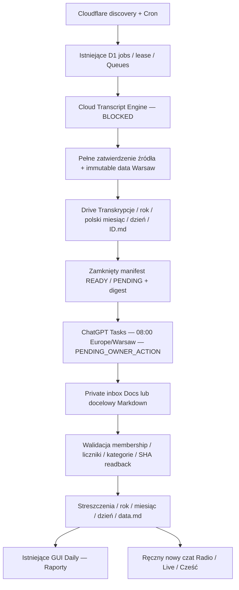

# Bartosz Intelligence — wykonanie zmiany 12.10.2026

**Status całości: PARTIAL. Pełne zdalne pozyskiwanie transkrypcji: BLOCKED.
Nowego workflow nie można jeszcze bezpiecznie włączyć produkcyjnie.**

Rzeczywisty kod znajduje się na branchu `codex/remote-daily-reports`. Nowe
funkcje przeszły lokalne testy. Nie wdrożono ich do produkcji, nie zastosowano
migracji 040, nie zapisano nowych danych do kanonicznych folderów Drive,
nie utworzono ChatGPT Task i nie uruchomiono płatnego modelu ani infrastruktury.
Dodatkowy koszt aktywowanych usług: **0,00 zł/miesiąc**. Nie jest to dowód,
że wymagany pełny zakres działa za darmo; jego bezpieczna zakwalifikowana
przepustowość cloud wynosi obecnie **0 transkrypcji/dzień**.

## Rzeczywiście zaimplementowane elementy

- Dwa adaptery native TypeScript/fetch w istniejącym kontrakcie TranscriptProvider:
  eksperymentalny browser-published JSON3 oraz oficjalny captions REST/SRT
  dla filmów, do których jest prawo edycji. Timestampy, rodzaj ścieżki, oryginalny
  język, raw SHA i brak automatycznej translacji/STT. Nie ma proxy, private cookies,
  rotacji klientów, atestacji ani płatnego fallbacku. Web adapter jest jawnie
  niekwalifikowany, a cloud runner odmawia pracy bez aktualnego Free admission.
- Trwałe, addytywne D1: siedem tabel, globalny serial lease/fencing, immutable
  pierwsze source approval i dedup po video ID. Nie powstaje druga kolejka
  transkrypcji: istniejące jobs/outbox/Queues/recovery pozostają autorytatywne.
- Atomowe enrollment w istniejącej akceptacji pełnego źródła. Data pierwszego
  zatwierdzenia według Europe/Warsaw, polskie nazwy miesięcy, dwucyfrowy dzień;
  complete source po północy trafia do nowej daty. Partial nie daje READY.
- Pełny archiwalny Markdown w Transkrypcje/Rok/Miesiąc/Dzień/ID.md, rezerwacja
  folder/file IDs przed zapisem, bounded retry i readback SHA/parent/version.
  Niejednoznaczny wynik POST odzyskuje ten sam plik. Błędny hash, obca edycja
  lub nieprywatne permissions wstrzymują zapis. Utrata prywatności rootu po
  konfiguracji wyłącza workflow i odbiera cached raportom oznaczenie kompletności.
- Zamknięty `_manifest.md` z pełnym zbiorem READY/PENDING i kopiowalnym digestem
  canonical JSON. Logical midnight uwzględnia DST; materializacja odbywa się
  w następnym bounded ticku, bez wymagania dokładnego wywołania o 00:00.
- Jeden raport na datę: exact metadata/IDs/counts/categories, zero duplicate
  summaries, jawne UNPROCESSED z przyczyną. Walidacja pełnego rozliczenia i
  powiązania z manifestem. Parser potwierdza strukturę; nie udowadnia sam
  semantycznej jakości streszczenia ani pełnego odczytu przez ChatGPT.
- Import native Google Docs przez text/plain i publikacja prawdziwego UTF-8
  `.md`; oryginał zachowuje rzeczywisty format i pozostaje na swoim miejscu.
  Nie potrzeba operacji move. Bezpośredni poprawny `.md` w właściwym folderze
  można przyjąć bez kopii. COMPLETE jest chroniony przed zastąpieniem inną
  treścią; PARTIAL można poprawić przez kontrolowane CAS/readback.
- Authenticated, CSRF-protected API i dodatkowy tryb **istniejącego** Daily:
  `/daily/RRRR-MM-DD?view=reports`, daty/kalendarz, cztery niepuste kategorie,
  rozwijane szczegóły, oryginalny YouTube, pełne źródło, liczby i brakujące ID.
  Odświeżanie przy widocznym oknie, cache no-store, bez publicznego report endpointu.
- Bezpieczna separacja: auto-planner starego AI i stary płaski archive exporter
  pomijają nowe daily_materials. Stare dane, Daily, jawne funkcje AI i historie
  pozostają dostępne; nie dodano wywołań Gemini jako zastępstwa Tasks.
- Backup/restore obejmuje nowy stan, jest kompatybilny z dawnymi schematami
  35–39, zachowuje dane i resetuje aktywację/lease do bezpiecznego OFF.
- Kompletny polski prompt Task 08:00, manualny runbook, audyt bibliotek,
  kosztów i możliwości Cloudflare oraz prywatny, rzeczywisty cloud PoC.

## Zmienione moduły i pliki

| Obszar                                                | Pliki                                                                                                                                                                                                                                                                                |
| ----------------------------------------------------- | ------------------------------------------------------------------------------------------------------------------------------------------------------------------------------------------------------------------------------------------------------------------------------------ |
| Kontrakt                                              | `packages/contracts/src/daily-report.ts`                                                                                                                                                                                                                                             |
| Doba, source enrollment, manifest, importer/publisher | `packages/core/src/daily/format.ts`, `enrollment.ts`, `drive.ts`, `workflow.ts`                                                                                                                                                                                                      |
| Transcript Engine i Free admission                    | `packages/core/src/transcript/providers/youtube-web.ts`, `youtube-captions.ts`, `packages/core/src/transcript/free-budget.ts`                                                                                                                                                        |
| Istniejący source pipeline                            | `apps/executor/src/transcript-runner.ts`, `local-worker.ts`, `packages/core/src/transcript/acceptance.ts`, `archive.ts`, `packages/core/src/artifacts/store.ts`, `packages/core/src/ai/jobs.ts`                                                                                      |
| Drive                                                 | `packages/core/src/drive/client.ts`                                                                                                                                                                                                                                                  |
| Backup i addytywna migracja                           | `db/migrations/040_daily_tasks_workflow.sql`, `db/migration-ledger.json`, `packages/core/src/backup/snapshot.ts`, `restore.ts`                                                                                                                                                       |
| API / scheduling                                      | `apps/api/src/daily-workflow.ts`, `routes/daily-reports.ts`, `env.ts`, `index.ts`, `routes/common.ts`, `routes/workers.ts`                                                                                                                                                           |
| Istniejący GUI                                        | `apps/web/src/features/daily-reports.tsx`, `daily.tsx`, `components/day-navigator.tsx`                                                                                                                                                                                               |
| Testy                                                 | `tests/unit/daily-report-format.spec.ts`, `transcript-cloud-providers.spec.ts`, `backup-restore.spec.ts`; `tests/workers/daily-tasks-workflow.spec.ts`, `daily-workflow-fixture.ts`, `artifacts.spec.ts`; `tests/e2e/daily-reports.spec.ts`                                          |
| Bezpieczne narzędzia                                  | `tools/deployment/daily-readonly-audit.ts`, `tools/probes/transcript-worker.ts`, `wrangler.transcript.jsonc`, `run-cloud-transcript.mjs`                                                                                                                                             |
| Handoff                                               | `README.md`, [decyzja i audyt](../../decisions/CLOUDFLARE_TRANSCRIPT_ENGINE_2026-10-12.md), [runbook](../../operations/DAILY_REPORTS_AND_RADIO.md), [pełny prompt](../../operations/CHATGPT_DAILY_TASK_PROMPT_PL.md), niniejszy raport i zanonimizowane receipts/logi w tym katalogu |

Nie zmieniono `Plan/`, zastanych publicznych evidence ani dwóch wcześniejszych
nieśledzonych receiptów backupu z 11.10.2026. Nie powinny wejść do tego commita.
Lista w PR stanowi pełny wykaz zmian publikowanych w Git.

## Przepływ danych

To przepływ zaimplementowanych kontraktów, z jawnymi nieaktywnymi granicami.
Nie jest ilustracją potwierdzonej automatyzacji produkcyjnej.

## Testy, środowisko i dowody

Windows, PowerShell, Node 24.21.0, pnpm 12.9.1, Vitest 4.1.11,
Wrangler/workerd 4.147.0 i Playwright/Chromium 1.63.0. Worker tests korzystają
z izolowanego lokalnego D1, E2E z fixture API i lokalnego Assets shell.
Python regression korzysta z istniejących przypiętych bibliotek bez sieci.
Procesy esbuild/workerd/Chromium uruchomiono z zatwierdzonym wyjątkiem sandboxu;
nie zmienia to tych testów w dowód działania produkcji.
Własne logi stdout mają znormalizowane końce linii i końcowe odstępy; ich treść
i wyniki, w tym pierwsze niepowodzenia, pozostały zachowane.

| Weryfikacja                                               | Rzeczywisty wynik i evidence                                                                                                                                                                                                 |
| --------------------------------------------------------- | ---------------------------------------------------------------------------------------------------------------------------------------------------------------------------------------------------------------------------- |
| `pnpm lint`                                               | PASS — [końcowy log](lint-final.log).                                                                                                                                                                                        |
| `pnpm format:check`                                       | PASS — [końcowy log](format-final.log).                                                                                                                                                                                      |
| `pnpm typecheck`                                          | PASS — [końcowy log](typecheck-final.log), obejmuje ostatnią zmianę testu source enrollment.                                                                                                                                 |
| Pełny unit + contracts                                    | **94 pliki, 574 PASS, 1 SKIP**, 71,97 s — [log](unit-contract-final.log). SKIP to istniejący test platformy innej niż Windows (`private-recovery-directory.spec.ts`).                                                        |
| Najnowsza regresja Free runnera                           | **12 PASS**, w tym dwa dodatkowe przypadki przed jakimkolwiek token/network/lease — [log](free-runner-regression.log). Wyniki nie sumują się z pełnym przebiegiem, bo większość przypadków pokrywa się.                      |
| Pełny Workers/integracyjny/failure                        | **64 pliki, 274 PASS**, 334,41 s — [log](workers.log). Wykonano przed ostatnią regresją prywatności i dodatkowym przypadkiem source enrollment.                                                                              |
| Regresja nowych dat/Drive/backup/artifact boundary        | **4 pliki, 69 PASS**, 159,89 s — [log](targeted-final.log)                                                                                                                                                                   |
| Ostatnia regresja prywatności dnia i kalendarza           | **14 PASS**, 20,96 s — [log](daily-privacy-regression.log)                                                                                                                                                                   |
| Końcowa pełna regresja artifacts + daily workflow         | **2 pliki, 45 PASS**, 114,53 s — [log](acceptance-enrollment-final.log). Obejmuje rzeczywisty lokalny worker RPC/upload/fenced approval z daily enrollment oraz pełny dotychczasowy wariant legacy.                          |
| Python                                                    | **15 PASS** — [log](python-regression.log)                                                                                                                                                                                   |
| Pełne E2E                                                 | **32 PASS**, 60,0 s — [log](e2e-final.log). Full/partial/missing, filtry, szczegóły, linki, legacy return, mobile overflow i axe.                                                                                            |
| Build                                                     | PASS; Vite oraz **dry-run** Worker, brak deploy — [log](build.log)                                                                                                                                                           |
| Config / registry / validators                            | PASS; paid_services_enabled=false — [config](config.log), [bundle](bundle.log)                                                                                                                                               |
| Migracje / fresh install / empty restore / FK / integrity | PASS, **40 migracji** — [log](migrations.log). Produkcja pozostaje na 39.                                                                                                                                                    |
| Public web build secret scan                              | PASS, 4 pliki, 418688 bytes, zero findings — [log](secrets.log). Wartości sekretów nigdy nie zapisane.                                                                                                                       |
| Pliki przeznaczone do commita                             | PASS — [skan sekretów](publication-secret-scan.json), konfiguracja sekretów i identyfikator właściciela porównane w pamięci; wcześniejsze receipty użytkownika wyłączone z publikacji. Nie jest to audyt całej historii Git. |
| Auth/security                                             | Istniejące Workers/failure i E2E oraz nowe owner/CSRF/scoped lease/permission/SSRF/no-redirect/schema cases; brak oddzielnego dostępnego security suite do pozornego zaliczenia.                                             |
| Rzeczywiste zdalne source/full readback                   | **BLOCKED** — [receipt Cloudflare](cloudflare-transcript-poc-2026-10-12.json)                                                                                                                                                |
| Rzeczywisty Drive write/import/report readback            | **BLOCKED**, nie wykonano writes — [API audit](production-readonly-2026-10-12.json), [UI permissions](drive-ui-permissions-2026-10-12.json)                                                                                  |

Historyczny `unit-contract.log` zachowuje pierwsze niepowodzenie starszego
fixture backupu: dodane tabele schema 40 występowały w symulowanym schema 36/37.
Naprawiono fixture, zachowano ścisłą walidację i zaliczono pełny ponowny przebieg.
`acceptance-enrollment-regression.log` zachowuje błąd nowej asercji fixture:
item ID odczytano z LeaseToken zamiast z item. Poprawiono identyfikator;
to błąd testu, nie zewnętrzna blokada. Pierwsza cloud próba parsera i późniejsza
diagnoza ochrony źródła są jawne w [historii PoC](cloudflare-poc-attempt-history-2026-10-12.json).
Nie poluzowano kryteriów ani nie zaliczono częściowej transkrypcji jako pełnej.

[Desktop — fixture](gui-report-desktop.png),
[telefon / brak raportu — fixture](gui-report-mobile-missing.png).
Screenshoty sprawdzono wizualnie; nie przedstawiają nowego raportu produkcyjnego.

## Etapy i testy A–F

| Etap                      | Status  | Zakres zaliczony / pozostały                                                                                                                                                                                     |
| ------------------------- | ------- | ---------------------------------------------------------------------------------------------------------------------------------------------------------------------------------------------------------------- |
| 0 — audyt                 | PASS    | Repo, source dziewięciu projektów, oficjalne ograniczenia, actual Cloudflare plan i Drive audit. [59 source files i pinned SHA](library-audit-2026-10-12.json).                                                  |
| 1 — architektura          | PASS    | D1/Queues/Cron jako istniejący control plane, native adapters, formaty, Warsaw, additive migration i zero paid fallback.                                                                                         |
| 2 — pełny zdalny pipeline | BLOCKED | Native adapter/Free guard/remote PoC istnieją. Pełne YouTube source nie jest zakwalifikowane; cloud collector/dispatcher i pełny CPU/readback nieaktywne. Lokalny executor w aktualnej produkcji nadal wymagany. |
| 3 — Drive                 | PARTIAL | Kod folderów, idempotencji, permissions i readback działa na fixture’ach; actual canonical roots publiczne i niedostępne dla aplikacji.                                                                          |
| 4 — ChatGPT Tasks         | PARTIAL | Prompt/manifest/parser/importer przygotowane i testowane; Task nie został utworzony, harmonogram ani jego rzeczywisty zapis niepotwierdzone.                                                                     |
| 5 — GUI                   | PARTIAL | Zaimplementowany i zaliczony lokalnie w istniejącym Daily; nie wdrożony do produkcji.                                                                                                                            |
| 6 — testy                 | PARTIAL | Dostępne lokalne checks zaliczone, rzeczywiste source→Drive→Task→Radio pozostaje niezrealizowane.                                                                                                                |
| 7 — handoff               | PASS    | Kompletne instrukcje i prompt dostarczone, owner actions wyraźne; ich wykonanie nie jest zaliczone.                                                                                                              |

Test A: kompletne źródła/cały suffix/Polish folders/dedup/no-captions/restart
zaliczone na fixture’ach; rzeczywiste pozyskanie cloud BLOCKED.
Test B: Warsaw midnight, DST 23/25 h, late approval i poprzedni dzień o 08:00
PASS lokalnie. Test C: jeden raport, exact membership lub jawne UNPROCESSED,
counts/hash/categories/links/idempotencja PASS lokalnie. Test D: readback,
pośredni Docs bez move, permission denial i retry PASS lokalnie; rzeczywisty
Drive write BLOCKED. Test E: authenticated backend, GUI/daty/filtry/details/
links/full/partial/missing PASS lokalnie. Test F: istniejąca regresja zaliczona
w zakresach powyżej; produkcyjna DoD nie jest spełniona.

## Rzeczywiste środowiska zewnętrzne

Cloudflare Billing/Subscriptions pokazał **Workers Free Active**; API do
subscriptions odpowiedziało 403, więc nie utożsamiono braku danych z Free.
Istniejące R2 Paid jest poza zakresem tej zmiany i nie jest używane.
[Plan receipt](cloudflare-free-plan-2026-10-12.json).

Zdalny preview bez production bindings/cron wykonał kod w **Cloudflare WAW**.
Watch metadata HTTP 200 wykazały angielskie ASR. Caption URL miał `exp=xpe`;
po jawnej diagnozie adapter zatrzymał się przed protected resource z
AUTH_REQUIRED/PROOF_OF_ORIGIN_REQUIRED. Nie uzyskano pełnych segmentów ani
porównania z pełnym źródłem. Nie obiecywać pobierania bez PC: potwierdzone jest
**zdalne wykonanie próby**, a nie niezależne działanie pełnego systemu.

Google Drive: **oba rooty mają „Każda osoba mająca link / Przeglądający”**,
potwierdzone w rzeczywistym UI. Aplikacyjny grant `drive.file + openid`
nie widzi żadnego z nich (DRIVE_NOT_FOUND). Nie zmieniono permissions, nie
poszerzono scope i nie zapisano danych w przypadkowym publicznym folderze.
Google Picker/grant per-file nie jest jeszcze skonfigurowany ani wdrożony
w aplikacji; nie przedstawiać go jako istniejącego przycisku. Zakres dostępu
do nowych plików ChatGPT wymaga osobnego rzeczywistego potwierdzenia.

## Czynności właściciela i decyzje przed produkcją

1. Naprawić publiczne permissions obu folderów; potem autoryzować konkretny
   dostęp aplikacji oraz ChatGPT i ponowić rzeczywisty read-only audit.
2. Rozstrzygnąć autoryzowaną, bezpłatną drogę pozyskiwania źródeł. Oficjalne
   API jest ograniczone do edytowanych filmów; pliki od autorów mogą stanowić
   inne legalne źródło, lecz nie zastępują automatycznie wszystkich kanałów.
   Żadna sprawdzona metoda nie spełniła dotąd całego wymaganego zakresu.
3. Dopiero po kwalifikacji źródła dokończyć/włączyć bounded cloud dispatcher
   i telemetry collector w istniejącym control plane, zmierzyć Free CPU/usage,
   sprawdzić pełny Drive readback bez lokalnego executora. Nie usuwać bramki
   kwalifikacji dla pozornego uruchomienia i nie aktywować płatnej alternatywy.
4. Zatwierdzić konkretny PR i plan deploy/backup, a dopiero po wszystkich
   bramkach zastosować 040 i konfigurację. Obecnie **aktywacja niedopuszczalna**.
5. Ręcznie utworzyć Task z [pełnym promptem](../../operations/CHATGPT_DAILY_TASK_PROMPT_PL.md)
   i według [instrukcji](../../operations/DAILY_REPORTS_AND_RADIO.md); potwierdzić
   08:00 Europe/Warsaw, cały actual report, parent i kontrolny odczyt aplikacji.
6. Sprawdzić nowy ręczny czat w istniejącym Radio, Live i powitanie „Cześć”.
   Projektowe instrukcje zachowano. Nie uruchamiano Live ani nowych czatów
   programistycznie; actual audycja pozostaje PENDING_OWNER_ACTION.

Pełna [tabela Free limitów, wolumenów 10/100/1000 i kosztów](../../decisions/CLOUDFLARE_TRANSCRIPT_ENGINE_2026-10-12.md#koszt-i-wolumen)
wykazuje 0,00 zł dodatkowego kosztu i zero aktualnie zakwalifikowanych
pełnych transkrypcji cloud. Nie uznajemy samego darmowego kodu ani promptu
za działającą, zakończoną automatyzację.
